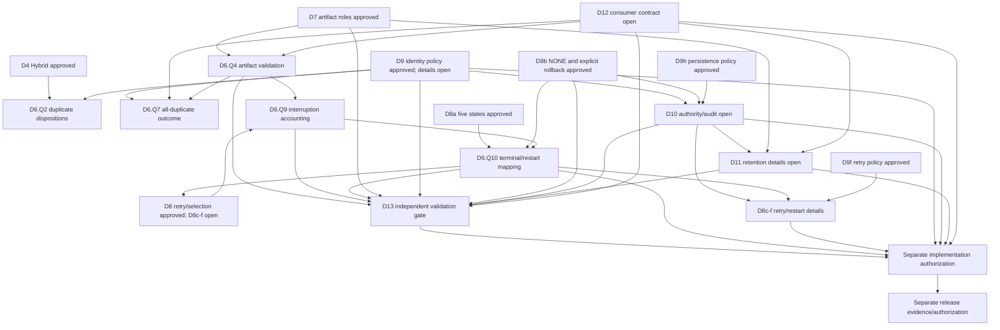

# Project Decision and Release-Unblocking Package

**Prepared:** 2026-10-30
**Repository:** `C:\Users\gbhan\Downloads\AI-Job-Automation-updated v1`
**Reference:** `RELEASE_READINESS_HANDOFF.md`

This package records the owner responses explicitly supplied for D1, D2, D3, and D5, alongside the remaining fillable decisions. Those four responses are **POLICY ONLY** and do not authorize implementation or establish a protected-file baseline. Recommendations elsewhere remain proposals unless separately recorded as approved.

## Current recorded gate status

- **Status reconciliation:** The original blanket D1–D13 “OPEN / UNAPPROVED” snapshot is preserved in the next bullet, but is not current per-ID authority. D1, D2, D3, D4, D5, the approved D6/D7/D8 scopes, and the D9 identity/D9f/D9h scopes recorded in the policy register are **OWNER APPROVED — POLICY DECISION ONLY**. D6.Q2/Q4/Q7/Q9/Q10 and technical details across D7/D9 remain open; D10 authority/audit, D11 retention specifics, D12 consumer compatibility, and D13 specialist validation remain open. No implementation is authorized. No approval date or individual identity was supplied.
- **Original package snapshot (preserved):** D1–D13: **OPEN / UNAPPROVED**. This package is not an approval record; use `PIPELINE_GENERATION_POLICY.md` for current per-ID status and explicit decision scope. Do not ask the owner to repeat already-recorded approvals.
- **Phase 66:** REJECTED for the current evidence-reader design. A different design may be proposed for a new review; that is not approval to test or integrate it.
- **Protected baseline:** six documented files matched in the recorded 2026-10-30 check; 15 entries remain unavailable. No replacement baseline was created.
- **Authentication incident:** OPEN / UNCONFIRMED pending owner/provider confirmation of revocation.
- **Runner redaction:** helper remains standalone; actual runner output is not verified as redacted. `run_offline_tests.py` remains protected.
- **Git:** status/diff failure has reproduced in restricted context. They succeeded in a prior write-enabled context. Cause is unconfirmed; the current restricted-context inventory is unknown.
- **AUTO_SUBMIT:** `false` was last verified. Do not change it.

## 1. Owner decision response template

This package asks only for unresolved choices. The policy register remains authoritative for approval status and exact scope. Explicitly excluded from repeat approval are D4 Option 3 Hybrid, the approved D6 scopes, D7’s seven artifact roles and bindings, D8 Option B selection and Option C retry, D8a Option A, D8b Option C, and the approved D9 identity, D9f retry, and D9h persistence scopes. All are policy-only. The D6 worksheet and D8/D9 register response fields remain the response locations for their subquestions; D10 and D12 responses are in this package.

For every unresolved item below, the **recommendation is a proposal, not a selected choice**. Any owner response is policy-only unless a separate implementation authorization is issued. Implementation impact for every decision is: production integration remains blocked; technical validation and implementation require their own approved scope.

## Authoritative policy and dependency matrix

`PIPELINE_GENERATION_POLICY.md` remains authoritative for each policy decision. This matrix summarizes only decisions explicitly present in the current records; it does not infer approvals from recommendations or implementation evidence.

| Decision | Approval status and approved scope | Remaining unresolved questions / dependencies | Implementation authorization | Specialist validation | Documentation locations |
|---|---|---|---|---|---|
| **D1** | **POLICY APPROVED — Option 3, no authoritative source yet.** Existing `jobs.csv` is unverified input; no completeness/authority claim without evidence; no new producer authorized. | Producer/source authority remains unset; completeness evidence thresholds and capture evidence remain open. Depends on D2 and later D6 source/count rules. | None. | D13 for acquisition/filesystem trust-boundary claims. | Policy register; response package D1 row; collection evidence policy. |
| **D2** | **POLICY APPROVED — exact-byte fingerprinting.** SHA-256 and byte size identify exact captured bytes used for parsing; provenance is separate; fingerprint alone does not prove completeness. | Provenance schema and completeness thresholds remain open: source type, capture/run ID, requested scope, observed execution evidence, capture time, parser/schema version. Depends on D1 and D6. | None. | D13 for secure snapshot capture/storage claims. | Policy register; response package D2 row; collection evidence policy. |
| **D3** | **POLICY APPROVED — strict input validation.** Missing title/company may be enriched then ineligible; missing/unusable ID/URL blocks; malformed CSV/headers/row widths fail stage; preserve duplicate occurrences and references; no silent discard or completeness claim for incomplete input. | Exact eligibility/enrichment source and field validation mechanics remain technical details; downstream accounting/disposition questions remain in D6. | None. | D13 for file-backed parsing/storage security claims. | Policy register; response package D3 row; D6 worksheet dependencies. |
| **D5** | **POLICY APPROVED — evidence-based failure classification.** Insufficient successful extraction is processed but quality-ineligible; extraction exception is failed occurrence; known invalid/missing input is stage failure; unknown interruption has unknown outcome; missing/corrupt/conflicting evidence fails closed; preserve confirmed outcomes/history. | Evidence thresholds and terminal-state/restart mapping remain open under D6/D8; no terminal state is inferred for unknown outcomes. | None. | D13 for persistence, interruption, and evidence-integrity claims. | Policy register; response package D5 row; D6 worksheet dependencies. |
| **D4** | **POLICY APPROVED — Option 3 Hybrid.** Preserve source occurrences; use approved identity before duplicate disposition. | Exact identity/disposition mechanics follow D6/D9; consumer and storage constraints D12/D13. | None. | D13 only for identity used as a security/storage trust boundary. | Policy register; response package; D6 worksheet. |
| **D6** | **POLICY APPROVED — PARTIAL.** Twelve principles and Q1, Q3 terminal equation, Q5, Q6 conditional, Q8. | Q2, Q4, Q7, Q9, Q10; remaining manifest/checkpoint details; D7/D8/D9/D10–D13 dependencies. | None. | D13 for storage, publication, durability, restart, concurrency claims. | Policy register; D6 worksheet; response package. |
| **D7** | **POLICY APPROVED — scoped.** Seven artifact roles, bindings, lifecycle-retention direction. | D6 status/validation, D11 periods/cleanup, D12 readers, D13 storage validation. | None. | D13 for secure storage, replacement, durability, concurrency. | Policy register; response package. |
| **D8** | **POLICY APPROVED — Option B selection; Option C evidence-based retry.** | D8c–D8f evidence/reporting details; D6 state mapping; D9 identity; D10 authority; D12/D13. | None. | D13 for persistence/restart/durability claims. | Policy register; D8 worksheets; response package. |
| **D8a / D8b** | **POLICY APPROVED — five states; explicit rollback authorization.** `PARTIAL` is nonselectable; failed/interrupted generation selection is `NONE`; rollback requires validated authority/evidence. | D6 terminal transitions; D10 authority/audit; D12 consumer behavior; D13 pointer/recovery validation. | None. | D13 for pointer publication, crash, concurrency, recovery. | Policy register; D8A/D8B worksheets; response package. |
| **D9 identity** | **POLICY APPROVED — scoped.** Verified nonblank Job ID preferred, normalized URL fallback; limited tracking-parameter/fragment removal; conflicts block; preserve occurrences/references and tracker/history; fail closed; migration needs explicit authorization. | Exact canonicalization, aliases, collision scope, legacy mapping, reconciliation mechanics; D10/D12/D13. | None; migration is not authorized. | D13 for persisted identity, audit, and migration integrity. | Policy register; response package; D6 worksheet dependencies. |
| **D9f** | **POLICY APPROVED — evidence-based retry eligibility.** Positive current non-submission evidence or authorized conflict resolution; confirmed/uncertain/missing/corrupt/unavailable/conflicting states do not permit retry; restart alone is insufficient. | Exact evidence sources/freshness and authority mechanics; D10/D12/D13. | None. | D13 for evidence persistence/integrity and restart claims. | Policy register; response package. |
| **D9h** | **POLICY APPROVED — persistence-failure handling.** Block pending authorized reconciliation; preserve confirmed outcomes; no automatic retry or precedence; no recovery journal. | Reconciliation/audit details; D10 authority, D12 compatibility, D13 validation. | None. | D13 for persistence, crash, durability, and reconciliation integrity. | Policy register; response package. |
| **D10** | **OPEN / UNAPPROVED.** | Authorized roles, action-bound authorization evidence, audit record, invalid/expired/conflicting evidence, separation of authority, protection/retention; D12/D13. | None. | D13 for audit-record integrity and storage guarantees. | Policy register D10 row; response package D10 brief. |
| **D11** | **OPEN / UNAPPROVED** for exact periods and cleanup details; D7 lifecycle direction is approved. | Retention windows/counts, cleanup authority, reader/writer coordination; D10/D12/D13. | None. | D13 for cleanup races, access, durability. | Policy register; response package D11 row. |
| **D12** | **OPEN / UNAPPROVED.** | Fixed-path exports, schema/row/empty/partial/`NONE` behavior, external/manual consumer inventory and compatibility window; D6/D7/D9/D13. | None. | D13 for consumer-specific secure filesystem boundaries. | Policy register D12 row; response package D12 matrix. |
| **D13** | **OPEN / UNAPPROVED; independent specialist gate mandatory for specified storage/security claims.** | Supported OS/Python/provider cells, threat model, evidence, reviewer qualification, acceptance criteria; depends on concrete design and separate authorization. | None. | Qualified independent filesystem/security specialist required; Phase 66 design remains rejected. | Policy register D13 row; Windows security review and specialist submission packages; response package. |

### A. Source and capture foundations

| Decision | Exact question and alternatives | Recommendation | Evidence and dependencies | Validation and implementation impact | Owner response |
|---|---|---|---|---|---|
| **D1 — Authoritative source** | Which source may be designated authoritative for a generation? **A:** owner-authorize a future collection producer; **B:** owner-designate a controlled manual/import snapshot; **C:** designate no source yet and treat existing `jobs.csv` only as an unverified input. A requires a producer/provenance/publication contract; B requires import authority and capture provenance but does not prove how completely an upstream search was collected; C blocks source-backed generation decisions until resolved. | C for now; do not designate a producer or import source by filename or convention. | No authoritative producer is established. `job_search.publish_collection()` rejects every outcome; `job_scraper.scrape_jobs()` returns candidate rows and does not write `jobs.csv`; `job_details` reads the fixed path. Collection publication remains separately closed. Depends on D2 and D6; D13 gates future file-backed acquisition. | For A/B, define authority, source type, producer/importer identity, run/capture identifier, source schema, and rejected-source behavior. Synthetic provenance checks may follow policy approval; no live collection, writer, or integration is authorized. | **OWNER APPROVED — OPTION 3: NO AUTHORITATIVE SOURCE YET — POLICY DECISION ONLY.** Existing `jobs.csv` is unverified; no new producer is authorized; no authority or completeness claim without evidence. |
| **D2 — Source identity, snapshot, and metadata** | What bytes define one source snapshot, what fingerprint binds it, and what provenance metadata must accompany it? **A:** capture one immutable byte sequence, parse those same bytes, and fingerprint the exact bytes; **B:** parse and fingerprint canonical records under a fully specified encoding/CSV/header/normalization contract; **C:** retain path/metadata without content fingerprint. A preserves exact serialization and duplicate rows but changes for byte-level formatting; B can treat formatting variants alike but may collapse meaningful differences unless normalization and multiplicity are exact; C does not bind the source contents. | A. Fingerprint exact captured bytes (including headers, encoding/BOM, line endings, quoting, and row order) with SHA-256 and byte size; keep producer/source role, authority reference, run/capture ID, requested query/location scopes, requested filter configuration and observed execution evidence, capture time, and parser/schema version as separate metadata. Unknown or unavailable values stay unknown/missing, never fabricated or represented as zero. | `pipeline_generation_store.fingerprint_bytes()` fingerprints exact bytes supplied to the isolated helper, and `read_verified_artifacts()` returns verified bytes to consumers; neither acquires nor parses a production source. Production has no shared immutable source snapshot, source fingerprint, producer/run provenance, or captured-file row count. Depends on D1, D6, and D13. | If B is selected, owner must define encoding, BOM, CSV dialect, headers, column order, normalization, and duplicate/order preservation before any validation design. Any selected option needs synthetic byte/parse/fingerprint consistency evidence; D13 must review secure acquisition and filesystem claims. **No capture implementation authorized.** | **OWNER APPROVED — EXACT-BYTE IDENTITY/FINGERPRINTING — POLICY DECISION ONLY.** Hash and size the exact captured bytes used for parsing; record the specified provenance separately. A fingerprint alone does not establish completeness. |
| **D1/D2 — Capture completeness and evidence** | What justifies treating a requested source as fully captured, including a valid zero-result capture? **A:** require independently supported requested and observed scope identity, settled results, terminal pagination/exhaustion evidence, cap-impact evidence, actual execution evidence for every intended filter, and an explicit disposition for every discovered occurrence; **B:** accept requested configuration, collector counts/caps, visible links, or absence of errors as sufficient; **C:** classify captures UNKNOWN when proof is absent and INCOMPLETE when evidence establishes unfinished work. A is strongest but requires new trustworthy evidence; B risks calling a partial or wrong-scope result complete; C preserves uncertainty and blocks false completeness. | C under current evidence. Do not infer the observed query from the requested query, executed filters from configuration/reason codes, exhaustion from fixed waits/scrolls, or a valid empty source from zero links. | `COLLECTION_EVIDENCE_POLICY.md` records requested scopes but no observed query/location identity, settled-state proof, pagination batches/terminal observation, or scope-level proof all filters ran. Production records ordered selector candidate occurrences and duplicate/cap/error observations, but occurrences are selector observations, not a complete authoritative result set; per-scope/cross-scope dedup affects the output pool. Clean production runs remain UNKNOWN; recorded errors, skipped scopes, or known cap interruption can make a run INCOMPLETE. Zero links alone is UNKNOWN. | Existing synthetic evidence models explicit scope, page state, filter assertion, batch sequence, exhaustion/cap effects, duplicate references, and UNKNOWN/INCOMPLETE precedence; it validates supplied structure, not live truth. Interrupted captures have no durable capture checkpoint proving completed versus remaining work. D1/D2/D6/D13; no live evidence gathering or production change authorized. | **OWNER APPROVED — POLICY DECISION ONLY (LIMITED SCOPE):** do not claim source authority or completeness without evidence, and do not use a fingerprint alone as completeness evidence. The complete evidence threshold for a completeness claim remains open; no collection is authorized. |
| **D6.Q1 — Expected/discovered counts (existing D6 response field)** | Which counts can be asserted? **A:** count rows in the approved captured snapshot as discovered occurrences; record an expected count only when an authoritative source supplies one with provenance; **B:** require expected and discovered counts for every capture; **C:** record captured rows only and omit upstream count comparison. An unavailable expected count is unknown, not zero. Selector-observation counts must not be substituted for captured source rows. | Option A is owner-approved: captured rows are individual occurrences; expected count is recorded only when supplied by an authoritative source, otherwise `UNKNOWN`, never zero; fingerprint alone does not prove completeness. | Production has counts for recognized selector candidate occurrences and requested scopes but no authoritative expected-result count, no proven complete result set, and no proof those observations became `jobs.csv` rows. D1/D2 determine whether any producer can supply expected counts. | Validate scope and count provenance against the captured snapshot; this is evidence validation, not manifest/accounting implementation authorization. | **OWNER APPROVED — OPTION A — POLICY DECISION ONLY.** Recorded in the existing D6 worksheet Q1 field and policy register. |

#### D1/D2 dependency effects

| Downstream decision | Effect of the D1/D2 answer |
|---|---|
| **D3/D5 input and failure rules** | D1/D2 determine which source and byte snapshot those rules apply to, and what input fields/metadata can be trusted. They do not decide eligibility, blank-description handling, or failure categories. |
| **D4/D9 duplicate identity** | D4 Option 3 remains approved and is not reopened. D9’s verified Job ID/URL continuity rules need source provenance and stable source values; D1/D2 do not decide identity equivalence or alias rules. |
| **D6 occurrence accounting** | The captured snapshot defines the row-occurrence denominator; a source fingerprint plus row ordinal can reference an occurrence. Expected counts may be compared only when an authoritative source provides them. D6.Q1’s existing worksheet response field is the sole approval location for count semantics and now contains the policy-only approval. |
| **D7 artifact roles** | D1/D2 provide source identity/fingerprint inputs and their provenance for cross-stage binding; D7 separately decides which outputs and diagnostics are required. |
| **D8 retry and restart** | The approved D8 policies remain unchanged. Source fingerprint availability affects whether retry/restart or rollback evidence can be matched; missing or contradictory provenance must not be inferred as a match. |
| **D12 consumer compatibility** | Source authority and CSV/schema identity inform compatibility exports and no-fallback requirements; D12 still owns the consumer contract and external inventory. |
| **D13 storage validation** | Any approved file-backed capture/fingerprint path needs supported-root, acquisition, race, and integrity review. D13 does not establish that a requested search was complete or that a producer was owner-authorized. |

### B. Occurrence accounting and artifact contracts

| Decision | Exact question and alternatives | Recommendation | Evidence and dependencies | Validation and implementation impact | Owner response |
|---|---|---|---|---|---|
| **D3 — Input eligibility, required values, and occurrence rules** | Which columns and nonblank values are required at each stage? For missing title/company, blank or unusable Link/ID, empty-valued or malformed individual rows, optional metadata, invalid values, whitespace, and missing provenance/completeness, choose rejection/failure, an explicitly approved skip, or processing with an ineligible/unverified disposition. **A:** require all identity and eligibility values up front. **B:** require usable source identity for detail work; allow recoverable metadata to be enriched and keep unresolved fields ineligible. **C:** define stage-specific column/value rules and exactly one disposition for every captured occurrence. D5 separately classifies file/parser and processing failures. | C, with B for recoverable metadata: never silently omit an occurrence; missing/unusable Link or identity is failed unless a specific owner-approved skip rule applies; unresolved title/company remain visible and ineligible after enrichment. | See the D3/D5 case matrix below for verified consumer behavior and synthetic evidence. The prior recommendation and current production behavior are not themselves the approval; the scoped owner response is recorded in the policy register. D1/D2 source constraints and D9 identity evidence remain relevant; D4 Hybrid and D6 row-occurrence preservation remain approved and are not reopened. | Synthetic required-header/value, link, whitespace, optional-field, row-shape, and occurrence-reconciliation validation after owner policy. D12 must confirm consumer contracts; D13 gates secured file access. **No input behavior change authorized.** | **OWNER APPROVED — STRICT INPUT VALIDATION — POLICY DECISION ONLY.** Apply the owner's stated title/company enrichment, missing ID/URL blocking, duplicate occurrence preservation, malformed-input stage failure, incomplete-source, and ambiguous-identity rules. Exact D6 accounting and D9 identity details remain open. |
| **D5 — Description quality and processing-failure boundaries** | Under the D3 input rules, when is absent/short/placeholder description processed but ineligible versus skipped or failed? Which per-record extraction errors, file/parser errors, stage-wide transform/output errors, and interruptions are failures, incomplete work, or unknown outcomes? **A:** successful fetch with inadequate text is processed/quality-ineligible; extraction exceptions fail the occurrence; known file/stage errors are stage-failure evidence. **B:** inadequate descriptions are skips under a specified rule. **C:** absent description is failure unless evidence proves successful extraction. D6 alone assigns generation accounting/terminal mapping; D7 decides which artifacts are required. | A as the conservative proposal. Do not conflate a successful blank result with an extraction exception. A known file/parser or stage error is failure evidence; it does not by itself establish a persisted terminal generation state. A write/diagnostic failure blocks completion only if D7 defines that artifact as required. Interruption without outcome evidence remains unknown and nonselectable. | See the D3/D5 case matrix below. Production can retain blank descriptions for both successful empty extraction and caught page exceptions; the analyzer separately emits `INSUFFICIENT_DATA`. No production generation state distinguishes these outcomes. Dependencies: D1/D2 input authority/completeness; D3 admissibility; D6 accounting/status; D7 artifact roles; D8 restart/retry; D12 consumer behavior. | Synthetic blank/placeholder/partial description, per-record exception, strict parsing, output and diagnostic replacement, and interruption boundaries. D13 is required for filesystem durability/crash claims, not quality policy. **No code, schema, artifact, or recovery implementation authorized.** | **OWNER APPROVED — EVIDENCE-BASED CLASSIFICATION — POLICY DECISION ONLY.** Apply the owner's stated insufficient-description, extraction-exception, known invalid/missing input, unknown-interruption, fail-closed evidence, and confirmed-outcome preservation rules. D6 generation accounting/terminal mapping remains open; D7 diagnostic role and evidence-binding direction is approved policy, with exact technical/status validation open. |

#### D3/D5 observed-case evidence (current behavior, not approved policy)

| Case | Verified production behavior | Existing helper/synthetic evidence and approval status | Occurrence/accounting effect and recommended owner rule |
|---|---|---|---|
| **Missing title** | `job_details` attempts page extraction/enrichment; if still blank, it writes the row. `job_analyzer` preserves it but sets `Application Eligible=No`. | Synthetic analyzer handoff cases confirm missing title is not promoted. Owner approved enrichment then ineligible status if still missing; this remains policy-only. | Apply the approved rule: permit enrichment; if still missing, mark ineligible. Preserve the occurrence; do not silently skip it. |
| **Missing company** | Same pattern as title: extraction/enrichment is attempted; a still-blank value is written and analyzer marks the row ineligible. | Synthetic handoff cases cover missing company; owner approved enrichment then ineligible status if still missing. | Apply the approved rule: permit enrichment; if still missing, mark ineligible. Preserve and account for the occurrence. |
| **Missing URL or job identifier** | A blank Link in `job_details` prints a message and continues without output or diagnostic. A malformed/nonblank Link may fail during page navigation and be caught as a per-record exception. `easy_apply` requires usable URL/ID evidence and blocks selection when absent or conflicting. | The pure `validate_link_value()` helper classifies missing/type/URL errors, but the inspected details input path does not call it. Synthetic identity tests cover missing URL/ID and conflicts; they are not production enforcement. | Owner approved that missing or unusable job ID/URL blocks processing. D5 classifies known invalid/missing input as stage failure. D9 identity verification/alias rules remain open; ambiguous identities must not be silently discarded. |
| **Duplicate input occurrences** | `job_details` processes each source row; analyzer carries rows through. Collection selector diagnostics preserve observed repeated links, while the collector/output pool can deduplicate by ID; `easy_apply` compares multiplicity across stages and can collapse consistent duplicate recommendation rows. | D4 Option 3 and D6 occurrence preservation are policy-approved only. Synthetic tests demonstrate behaviors; no end-to-end generation ledger exists. | Preserve each captured row occurrence per approved D4/D6. Exact duplicate disposition and survivor reference remain D6/D9 decisions; do not ask to approve D4 again. |
| **Empty, malformed, or wrong-width rows** | `job_details` and `job_analyzer` use strict CSV parsing, require exact-case headers, and reject inconsistent row widths. Empty input lacks required headers and errors; header-only input passes header validation and returns early without new output. Empty-valued cells are not themselves malformed; a blank-link row follows the silent skip above. | `csv_contracts` synthetic tests cover empty/header-only input, missing/extra/duplicate headers, case, and strict unterminated quotes. They test helper contracts, not all production edge cases. | Owner approved malformed CSV, missing required headers, and inconsistent row widths as stage failures. Header-only is not proof of complete source acquisition and remains subject to D1/D2 and D6. Disposition of other empty-valued parsed rows and the exact required-header list remain unresolved. |
| **Missing optional metadata / invalid types / whitespace** | Current detail/analyzer contracts require the listed columns even where cell values may be blank. CSV cells are strings; `.strip()` trims outer whitespace. `job_details`/analyzer reject `None` cells from short rows and extra-field rows, but do not treat every blank cell as malformed. `easy_apply` normalizes header names in its identity reader, unlike the exact-case stage contracts. | Synthetic CSV helper tests cover exact header matching and pure link type/whitespace validation; the validator is not wired as the detail-input gate. | Recommend define required columns separately from required nonblank values; trim outer whitespace before validation; reject invalid shape/type; preserve allowed missing metadata but mark it unresolved/ineligible. D12 must reconcile differing consumer header behavior. |
| **Missing source provenance or completeness evidence** | Fixed-path consumers do not validate producer authority or prove the source is a complete capture. `easy_apply` performs file timestamp and row-identity consistency checks, not source-capture proof. Production collection remains UNKNOWN when clean and publication remains closed. | `COLLECTION_EVIDENCE_POLICY.md` and synthetic collection tests distinguish UNKNOWN from INCOMPLETE and state that supplied evidence does not prove live truth. D1/D2 owner limits are now approved, but production completeness evidence remains absent. | Apply the approved rule: no source authority/completeness claim without evidence, and a fingerprint alone is insufficient. D1/D2 do not specify the full evidence threshold; D6 selection/accounting remains fail-closed. |
| **Blank/insufficient description** | Details extraction may successfully return blank; analyzer labels blank, placeholder, or below-threshold descriptions `INSUFFICIENT_DATA`, retains the analysis row, and marks it ineligible. | `job_details` synthetic tests cover blank description after bounded wait; analyzer handoff synthetic cases cover missing description. D5 outcome is policy-approved only; synthetic evidence is not implementation. | Owner approved successful extraction with insufficient description as processed but quality-ineligible. No implicit skip is authorized. |
| **Individual record failure / parsing or missing-input failure** | Details catches page-level exceptions, keeps a blank-description row, and records diagnostics; missing input, bad required headers, row-width mismatch, or strict CSV parse failure raises before row processing. Analyzer input errors similarly raise; per-row transformation errors have no generation-level classification. `easy_apply.load_csv()` returns an empty list for a missing file, while its identity gate blocks missing stage files and read/identity errors. | Synthetic scraper/CSV/identity tests cover selected failures and fail-closed selection, but do not create production generation statuses. | Owner approved extraction exceptions as failed occurrences and known invalid/missing input as stage failure. D6 still decides occurrence accounting and terminal mapping. |
| **Partial, interrupted, or diagnostic-only failure** | Details can retain successful and failed-row outputs, then replaces CSV and diagnostics as separate files; a failure between replacements can leave mismatched outputs. Analyzer writes after processing completes. There is no durable generation checkpoint or terminal status. A diagnostic-only warning does not itself change an output row’s status; a diagnostics write failure can occur after CSV replacement. | Isolated helper tests model artifact mismatch and interruption boundaries; they are not production recovery behavior. D6/D7/D8 decisions govern terminal/accounting treatment. | Owner approved unknown interruption as unknown, with no invented terminal state, and missing/corrupt/conflicting evidence as fail-closed/block-selection. D6/D7 still decide generation status, required artifacts, and diagnostic failure effects. D8b’s `NONE` policy remains in force; no implementation is authorized. |

#### D3/D5 effects on approved D6 direction and pending details

| D6 area | Effect of D3/D5 owner choices |
|---|---|
| **Captured occurrence accounting — D6.Q3/Q8/Q9** | Each captured source row remains a separate occurrence under approved D6. D3/D5 decide input and processing disposition meanings; D6 defines the equation, threshold, and interruption accounting. Silent omissions cannot reconcile. |
| **Duplicate preservation — D6.Q2/Q7** | D4 Hybrid and D6 occurrence preservation remain approved. D3/D5 must not collapse repeated rows; exact duplicate identity/disposition and retained-row references remain dependent on D9 and existing D6.Q2/Q7 response fields. |
| **Expected/discovered counts — D6.Q1** | D3/D5 do not establish upstream expected counts. D6.Q1 Option A is approved: count captured rows as occurrences and use `UNKNOWN` absent an authoritative expected count. D1/D2 evidence still limits completeness claims; a captured-row count is not proof of complete search discovery. |
| **All-skipped/all-duplicate — D6.Q5–Q7** | D3/D5 determine which rows are eligible, skipped, or failed; D9 determines verified duplicate identity. Q5’s distinct source-empty/result-empty evidence and Q6’s conditional all-skipped `EMPTY` rule are approved. Q7 all-duplicate status remains open and depends on D9, D7 roles, and D12 consumers. |
| **`EMPTY`/`PARTIAL` — D6.Q5–Q8** | Q5 distinguishes valid zero-row source from completed zero-eligible output; Q6 conditionally permits all-skipped `EMPTY`; Q8’s `PARTIAL` threshold is approved. D7 required artifacts, D12 consumer behavior, and D13 integrity validation remain operational dependencies; Q7 remains open. Do not infer status from current CSV rows. |
| **Artifact validation — D6.Q4 / D7 roles** | D7’s seven role requirements and evidence-binding direction are policy-approved; D6.Q4 still decides per-artifact validation details. D3/D5 identify occurrence and diagnostic evidence. D12 consumer behavior and D13 storage review remain gates. A mismatched output/diagnostics pair cannot prove completion. |
| **Restart/retry — D6.Q9/Q10; D8c–D8f** | Under approved D8 policy, failed/interrupted selection is `NONE` and retry is evidence-based. D3/D5 dispositions may support retry evidence only if durably validated; absent/corrupt state is blocked, not inferred as non-submission or success. D10 audit and D13 durability validation remain gates. |

**What D3/D5 and D7 approvals enable:** D6 may use approved input and quality/failure meanings, while D7’s seven role requirements and evidence-binding direction are approved at the recorded policy scope. D6.Q1, Q3 terminal equation, Q5, Q6, and Q8 are also approved at their stated scopes; this does not establish source completeness, close D6.Q2/Q4/Q7/Q9/Q10, resolve D9–D13 details, or authorize implementation. D9 identity blocks duplicate linkage; D10 authority/audit, D11 retention specifics, D12 consumer behavior, and D13 specialist validation remain open. D7 approval does not resolve D6 per-artifact validation or authorize storage, publication, cleanup, or production changes.

#### D6 question-by-question dependency readiness

Classifications below describe owner-decision readiness, not implementation readiness. The D6 worksheet remains the response location for Q1–Q10.

| D6 question | Dependency classification | Can progress using current evidence? | Remaining dependency / reason |
|---|---|---|---|
| **Q1 Expected/discovered counts** | **POLICY APPROVED — OPTION A** | Count captured rows as individual occurrences; record expected only when supplied by an authoritative source; otherwise `UNKNOWN`, never zero. | No authoritative source or expected count exists today. This is an evidence limitation; the approved policy does not make current counts complete. |
| **Q2 Duplicate occurrence dispositions** | **Requires multiple dependencies** | D4 hybrid handling, D6 occurrence preservation, and D3 occurrence preservation are approved; do not repeat them. | Exact identity/alias and retained-occurrence references depend on D9; source ordering/fingerprint policy is recorded under D2. Exact D6 disposition/rule fields remain open. |
| **Q3 Manifest fields/accounting equation** | **PARTIALLY POLICY APPROVED — TERMINAL EQUATION ONLY** | Option A is approved: exactly one mutually exclusive disposition; reconcile `captured = processed + skipped + failed + unprocessed`; preserve all four categories; evidenced terminal `FAILED` may contain accounted `UNPROCESSED`. | Manifest fields, output links, checkpoint/restart semantics, and other terminal mappings remain open. D9 duplicate references and D8/D10/D13 checkpoint/audit/security gates remain. No schema is authorized. |
| **Q4 Required artifacts/per-role validation** | **Owner policy recorded; technical details blocked by D6/D12/D13** | D7 role requirements and binding scopes are approved; D6.Q4 still needs per-role validation criteria and exact status behavior. | Final validation depends on D6 status rules, D12 consumer/header behavior, and D13 filesystem validation. Q4 remains open in its existing field. |
| **Q5 `EMPTY` semantics** | **POLICY APPROVED — OPTION C** | Preserve separate evidence for valid zero-row source and valid completed zero-eligible output; zero output alone does not prove completeness. | D7 roles, D12 consumer behavior, and D13 integrity validation remain gates for an operational contract. |
| **Q6 Fully accounted all-skipped** | **POLICY APPROVED — OPTION A, CONDITIONAL** | `EMPTY` only with an approved skip reason for every occurrence, reconciled accounting, and valid required artifacts; preserve occurrences and skip evidence. | D7 required roles and D12 zero-row behavior remain operational dependencies; zero output alone is insufficient. |
| **Q7 Fully accounted all-duplicate** | **Requires multiple dependencies** | D4/D6/D3 occurrence-preservation principles remain approved; no repeat approval. | Exact identity/retained occurrence depends on D9; source references on D1/D2 evidence; D6 status also depends on D7 artifacts and D12 zero-output behavior. |
| **Q8 `PARTIAL` threshold** | **POLICY APPROVED — OPTION A** | Require processed and failed occurrences, reconciled occurrence accounting, and valid required artifacts. `PARTIAL` remains nonselectable under approved D8a. | D7 role definitions and D13 publication validation remain gates; D8a remains unchanged. |
| **Q9 Interrupted-run accounting** | **Blocked by D8/D10/D13** | D5 leaves unknown interruption outcomes unclassified; no transition can be assigned from file presence alone. | Approved D8a/b constrain vocabulary/selection; detailed durable evidence and audit rules require D8/D10; crash consistency requires D13. D7 identifies required evidence roles; technical validation remains open under D6.Q4. |
| **Q10 Terminal-state/restart mapping** | **Blocked by D8/D10/D13** | No mapping can close now. | Depends on approved D8a/b boundaries plus unresolved D8c–D8f, D10 authority/audit, D12 consumers/no-fallback, and D13 storage/restart validation; D5 does not assign generation terminal states. |

**Recorded D6 responses:** Q1, Q3 terminal equation only, Q5, Q6 conditionally, and Q8 are policy-approved at the scopes shown. Q2, Q4, Q7, Q9, and Q10 remain pending. No D6 question is implementation-ready. D7 role/binding/retention-direction decisions are separately policy-approved; technical validation remains open.

| **D6.Q2 — Duplicate dispositions** | How does each verified duplicate occurrence enter the ledger? **A:** preserve each occurrence; disposition redundant occurrences as rule-based skips linked to retained occurrence; **B:** collapse before ledger with separate side-map; **C:** fail any duplicate source. | A, consistent with approved D4/D6 baseline; this does not reopen D4. | D4 hybrid policy and D6 row-based occurrence principle are approved; exact disposition/rule fields remain open. Depends on D1/D2, D4/D9. | Synthetic multiplicity, retained-reference, ambiguous-identity and output-link tests. **Ledger design remains unauthorized.** | Use existing blank response field in D6 worksheet Q2. |
| **D6.Q3 — Accounting equation/manifest fields** | What terminal accounting record is required? **A:** one mutually exclusive disposition per occurrence and reconcile captured = processed + skipped + failed + unprocessed; **B:** aggregate counts only; **C:** add explicit pending/checkpoint dispositions for `IN_PROGRESS`. | **OWNER APPROVED — OPTION A FOR THE TERMINAL EQUATION ONLY.** An evidenced terminal `FAILED` generation may include accounted `UNPROCESSED`; an occurrence not reached is not `FAILED`. Checkpoints and manifest details remain pending. | v1 helper uses aggregate counts; v2 proposal has per-occurrence ledger/output links; contracts differ. Depends on D1/D2, D3–D5, D8, D10, D13. | Synthetic conservation and restart tests; durability claims require D13. **No schema/manifest/checkpoint implementation authorized.** | Approval is recorded in the existing D6 worksheet Q3 response field; no second response field. |
| **D6.Q4 — Per-artifact validation against approved D7 roles** | What byte/hash/format/header/row-width/count/cross-stage checks are required before each approved D7 role can support a status or selection? D7 role requirements and bindings are approved; do not reopen them. | Apply the approved D7 role matrix and define explicit per-role checks; fail closed on missing, malformed, corrupt, or conflicting required evidence. Header-only CSV alone never proves `EMPTY`. | Isolated helper/verifier contain role/hash/parse/count checks, but output contracts differ and are not production-integrated. Depends on D6 status rules, D12 readers, D13. | Synthetic missing/zero-byte/malformed/header-only/mismatched artifact matrix; D13 for path/atomicity/durability claims. **No artifact publication authorized.** | Use the existing D6 worksheet Q4 field. D7 role decisions are recorded below. |
| **D6.Q5 — `EMPTY`** | **A:** valid zero-row source only; **B:** any valid completed zero-eligible result; **C:** preserve separate source-empty/result-empty evidence under the existing five-state vocabulary. | **OWNER APPROVED — OPTION C — POLICY ONLY.** Preserve evidence for both cases; zero output alone does not prove completeness. | D8a vocabulary is unchanged. D7 role choices are approved; D6.Q4 per-artifact checks and D12 consumers still affect operational validation. | Validate valid source/accounting and consumer zero-row behavior; no status transition or publication authorized. | Approval is recorded in the existing D6 worksheet Q5 response field; no second response field. |
| **D6.Q6 — All-skipped** | If a nonempty source is fully and validly skipped, choose **A:** `EMPTY` conditionally; **B:** `COMPLETE`; or **C:** remain blocked/unclassified. | **OWNER APPROVED — OPTION A, CONDITIONAL — POLICY ONLY.** Every occurrence needs an approved skip reason, reconciled accounting, and valid required artifacts; preserve source occurrences and skip evidence. | Approved D7 roles require per-artifact checks under D6.Q4; D12 zero-row behavior remains an operational dependency. | Synthetic full-ledger, skip-rule, and consumer cases; no status implementation authorized. | Approval is recorded in the existing D6 worksheet Q6 response field; no second response field. |
| **D6.Q7 — All-duplicate** | If every occurrence maps to a retained occurrence but eligible output is zero, choose **A:** `EMPTY` when approved dedup leaves zero eligible rows; **B:** `COMPLETE` when dedup/accounting completes; or **C:** block until identity/retention meaning is settled. A/B risk assuming D4 identity rules settle generation status. | C pending identity, retention, and eligibility semantics. | D4 hybrid and D6 occurrence preservation are approved; exact D4/D9 rules and status are not. Depends on D3/D4/D5, D6.Q4 artifact validation, D9 identity, and D12 consumer behavior. | Collision/multiplicity/retained-reference and output reconciliation cases. **No dedup/status implementation authorized.** | Use existing blank response field in D6 worksheet Q7. |
| **D6.Q8 — `PARTIAL` threshold** | Choose **A:** require processed and failed occurrences, reconciled accounting, and valid required artifacts; **B:** any mixed result with diagnostics; or **C:** classify every failure as `FAILED`. | **OWNER APPROVED — OPTION A — POLICY ONLY.** `PARTIAL` remains nonselectable under D8a. | D7 role definitions, D8a selection rule, and D13 publication validation remain gates. | Synthetic one-success/one-failure, all-failed, stage failure, unresolved occurrence, and invalid publication cases; no implementation authorized. | Approval is recorded in the existing D6 worksheet Q8 response field; no second response field. |
| **D7 — Required roles, evidence binding, and retention** | For each stage/status, which candidate roles are required, conditional, or not applicable; what minimum content and source/generation binding applies; and what retention/cleanup rule protects selected and rollback evidence? **A:** exact status-specific role set; **B:** core data roles required while diagnostics are optional; **C:** permit any available subset. B/C can leave status unsupported by evidence; A requires explicit empty/failed behavior and consumer compatibility. | **OWNER APPROVED — POLICY DECISION ONLY:** record the seven role requirements and evidence bindings below. Lifecycle-based retention is approved as direction only; protect selected/rollback generations and tracker/history from automatic generation cleanup; cleanup requires explicit owner authorization. Exact periods, counts, schedules, and cleanup details remain open under D11. | Production has fixed-path outputs and diagnostics but no generation binding; early returns can leave previous files. Helper role contracts are isolated. Depends on D6, D9–D13 as listed below. | Per-stage/status validation, consumer checks, and D13 storage/security review remain necessary. **No role/schema/publication/cleanup change authorized.** | **OWNER APPROVED — POLICY DECISION ONLY.** Full scope recorded below; no date, name, or reviewer identity supplied. |

#### D7 owner decisions — policy approved scope; implementation not authorized

The production column describes existing artifacts or their absence. The role requirements, evidence-binding points, and lifecycle-retention direction explicitly listed as approved below are **OWNER APPROVED — POLICY DECISION ONLY**. No schema, artifact publication, cleanup, or production behavior is authorized. D6’s approved Q1/Q3-terminal-equation/Q5/Q6/Q8 scopes and prior accounting principles are preserved. D6.Q2/Q4/Q7/Q9/Q10 remain open.

| Artifact role | Purpose and current production behavior | Owner-approved requirement and evidence binding | Technical validation still required | Dependencies / unresolved detail / specialist gates |
|---|---|---|---|---|---|
| **Source snapshot** | Defines processed input and provenance. Production reads fixed-path `jobs.csv`; no authoritative producer or generation-bound snapshot exists. | **REQUIRED for each captured source run.** Bind to exact captured bytes, SHA-256, byte size, and provenance. | Source authority/completeness, same-byte hashing/parsing, schema/count, and supported storage validation remain technical gates; fingerprint alone is not completeness proof. | D1/D2 source evidence; D6.Q1; D12 fixed-path compatibility; D13 secure acquisition/filesystem review. No producer authorized. |
| **Stage outputs** | Details and analysis are written to fixed paths `data/job_details.csv` and `data/job_analysis.csv`; early returns can leave old files. | **REQUIRED for each completed stage.** Bind each output to source identity and generation identity. | Define per-stage/status formats, counts, hashes, cross-stage consistency, and empty-output behavior; missing/corrupt/conflicting evidence blocks selection under existing policy. | D6.Q4 and remaining status decisions; D12 consumer contract; D13 replacement/durability review. |
| **Diagnostics** | `data/job_details_diagnostics.json` is written separately; collection diagnostics are in-memory and do not prove completion. | **CONDITIONAL.** Required when needed to explain failures, skips, incomplete outcomes, or validation results; bind to corresponding stage and generation. | Specify diagnostic schema, occurrence coverage, and absent-versus-valid-empty distinction; technical validation remains open. | D3/D5; D6.Q4/Q9/Q10; D12 if externally consumed; D13 storage/replacement/crash review. |
| **Occurrence accounting** | No production ledger exists; collection selector observations/counters are not a complete source-row ledger. | **REQUIRED for each stage processing source occurrences.** Bind each disposition to its source occurrence. | Apply approved Q3 terminal equation; validate reference uniqueness, reconciled counts, disposition evidence, and any output mapping; do not invent unknown outcomes. | D6.Q2/Q4/Q7/Q9/Q10; D9 duplicate identity; D11 retention; D13 integrity/durability review. |
| **Generation manifest** | No production manifest exists; `pipeline_generation_store.py` is isolated helper behavior. | **REQUIRED for every generation.** Bind source identity, status, occurrence accounting, and artifact-validation evidence. | Exact schema/version, identity/status constraints, accounting fields, artifact evidence, and cross-stage checks remain technical details; fail closed on missing/corrupt/conflicting evidence. | D6.Q3 remaining manifest fields and Q4/Q9/Q10; D8; D10 audit; D12 readers; D13 persistence/crash/concurrency review. |
| **Selection pointer history** | No production pointer or publisher exists; isolated helper validates pointer-shaped data only. | **REQUIRED when selection, reselection, or rollback decisions occur.** Record selected generation and relevant decision evidence; preserve D8b `NONE` and explicit rollback policy. | Define event identity, ordering, integrity, and audit evidence; validate target completeness/source compatibility and no stale fixed-path fallback. | D6.Q10; D8/D8a/D8b; D10 authority/audit; D12 `NONE`/export behavior; D13 publication/filesystem review. |
| **Tracker/history evidence** | Separate persistent `data/application_tracker.csv` and `data/application_history.csv`; no contents inspected or changed. | **REQUIRED and separate from generation artifacts.** Preserve independently; generation operations must not silently overwrite these records. | D9 identity/provenance and conflict checks, D10 authority/audit, and safe independent preservation; malformed/missing evidence cannot imply clear/unapplied. | D9 identity/continuity; D10 authority/audit; D11 independent retention; D12 consumers; D13 if persistence/concurrency/integrity claims change. |

The role and binding statements in this matrix record the owner-approved D7 policy scope only. They do not approve schemas, validation implementation, artifact publication, cleanup behavior, or production changes. D6.Q4 remains the response location for per-artifact validation details; D11 retains the exact retention/cleanup decisions. D13 specialist review is a separate technical gate.

**D7 status:** The owner has approved the seven role requirements, listed bindings, and lifecycle-retention direction as policy only. No D7 policy response resolves D6.Q2/Q4/Q7/Q9/Q10; D9 identity; D10 authority/audit; D11 exact retention details; D12 consumer compatibility; or D13 specialist validation. These remain technical/owner gates for detailed contracts and any implementation.

#### D7 retention — lifecycle direction approved; specifics open

| Evidence role | Owner-approved policy direction | Remaining D11 decision and consequences | Dependencies |
|---|---|---|---|
| **Source snapshots** | Lifecycle-based retention approved; selected and rollback generations are protected from automatic cleanup. | Define the source-evidence lifecycle and any eventual period/count/schedule under D11; overly short retention can lose provenance. Cleanup requires explicit owner authorization. | D1/D2; D8b; D11; D13 cleanup-race/storage validation. |
| **Stage outputs** | Lifecycle-based retention approved; selected and rollback generations are protected from automatic cleanup. | Define retention with the generation lifecycle and consumer needs; current-only retention can destroy rollback evidence. Cleanup requires explicit owner authorization. | D6 statuses; D8b; D11; D12; D13. |
| **Diagnostics** | Lifecycle-based retention approved; diagnostics remain conditional per the approved role decision. | Define retention for diagnostics needed to explain failures, skips, incomplete outcomes, or validation; shorter retention can remove unresolved evidence. Cleanup requires explicit owner authorization. | D6.Q4/Q9/Q10; D11; D12; D13. |
| **Occurrence accounting** | Lifecycle-based retention approved; selected and rollback generations are protected from automatic cleanup. | Define retention with the source snapshot and generation; premature cleanup can remove per-occurrence proof. Cleanup requires explicit owner authorization. | D6.Q2/Q4/Q7/Q9/Q10; D9; D11; D13. |
| **Generation manifests** | Lifecycle-based retention approved; historical records must not be silently overwritten by generation operations. | Define retention with each generation and its artifacts; current-only retention can weaken restart/rollback evidence. Cleanup requires explicit owner authorization. | D6 remaining fields/statuses; D8b; D10; D11; D12; D13. |
| **Selection pointer/history** | Lifecycle-based retention approved; history is required whenever selection/reselection/rollback decisions occur. | Define event-history retention and audit authority under D10/D11; shorter retention can impair audit/restart analysis. Cleanup requires explicit owner authorization. | D8b; D10; D11; D12; D13. |
| **Tracker/history records** | Lifecycle-based retention approved independently; evidence is protected from generation cleanup and silently overwriting is prohibited. | Define independent retention/archive/deletion rules; coupling to generation cleanup risks loss of application continuity and audit evidence. Cleanup requires explicit owner authorization. | D9; D10; D11; D12; D13 as applicable. |

**Recorded owner response:** **OWNER APPROVED — POLICY DECISION ONLY.** (1) Source snapshot required per captured source run. (2) Stage outputs required per completed stage. (3) Diagnostics conditional when needed to explain failures, skips, incomplete outcomes, or validation results. (4) Occurrence accounting required per stage processing source occurrences. (5) Generation manifest required for every generation. (6) Selection-pointer history required when selection, reselection, or rollback decisions occur. (7) Tracker/history evidence required and separate from generation artifacts. Approved bindings: source snapshot to exact bytes/SHA-256/byte size/provenance; outputs to source and generation identity; diagnostics to corresponding stage/generation; each disposition to its source occurrence; manifests to source identity/status/accounting/artifact-validation evidence; selection history to selected generation/relevant decision evidence; tracker/history independently preserved and not silently overwritten by generation operations. Lifecycle-based retention is approved as direction; selected/rollback generations and tracker/history are protected from automatic generation cleanup; cleanup requires explicit owner authorization. No periods, counts, schedules, or identities/dates were supplied.

**Still open / not implementation-ready:** D6.Q2/Q4/Q7/Q9/Q10; D9 identity contract; D10 authority/audit specifics; D11 retention periods/counts/schedules and cleanup details; D12 consumer compatibility; D13 independent specialist validation; and detailed D7 validation/implementation contracts. The recorded D7 policy approval does not resolve these dependencies or authorize implementation.

#### D6/D7 dependency reconciliation

| Dependency | Effect on D6/D7 questions | Can progress now? |
|---|---|---|
| **D1/D2 — source authority/completeness** | D1/D2 policy choices are approved, but no authoritative producer or completeness proof exists; D6.Q1’s rule is approved and current expected count remains `UNKNOWN`; Q3/Q5 still require source evidence for any concrete classification. | Decisions recorded policy-only. Remaining D6 closure and operational use require their own responses and supporting source evidence. |
| **D3/D5 — input, skip, quality, failure** | Approved scoped meanings inform D6 accounting/status decisions and potential diagnostic content; D6 owns generation accounting/status and D7 artifact requirements. | Decisions recorded policy-only. Remaining D6 questions and D7 technical/status validation remain open; approved input rules do not select terminal states or authorize artifact implementation. |
| **D4/D9 — duplicate policy/identity** | D4 Hybrid and D6 occurrence preservation remain approved; D9 details gate Q2/Q7 retained-occurrence rules and occurrence-accounting validation. | No D4 repeat approval. D9 identity details remain owner-open and block exact duplicate dispositions. |
| **D8 — retry/selection** | Constrains Q8–Q10 and the selection-pointer role; D8c–D8f details remain pending. | High-level D8 policy is approved; no implementation is authorized. |
| **D10 — rollback authority** | Governs Q3 checkpoint/audit evidence beyond the approved terminal equation, plus Q8–Q10 failure/restart/reconciliation records. | Owner authority/audit questions can be reviewed; durable audit validation still needs D13. |
| **D11 — retention/cleanup** | Governs retention of source snapshots, outputs, diagnostics, ledgers, manifests, pointers, and existing application-state evidence. | Lifecycle-based retention direction is approved; exact periods/counts/schedules and cleanup authority remain open under D11. |
| **D12 — consumer compatibility** | Blocks final Q4–Q7 role/status behavior and selection-pointer `NONE`/empty/no-fallback consumption. | Consumer inventory/contract can be reviewed now; external consumers remain unknown until owner inventory is supplied. |
| **D13 — independent storage validation** | Specialist gate for secure acquisition/storage, artifact replacement, durability, crash consistency, concurrency, pointer publication, and recovery claims across D6/D7. | Requires a documented concrete design and separately authorized supported-environment tests; it does not approve owner policy or artifact roles. |

**Ready for owner review now:** Do not request the seven D7 role/binding choices or the lifecycle-retention direction again; those are approved policy-only. D11 specifics and D12 consumer decisions remain open for owner review. D6.Q1, Q3 terminal equation, Q5, Q6, and Q8 have also been approved and must not be requested again. Q2/Q7 remain dependency-limited; Q4/Q9/Q10 remain open. None of these decisions authorizes implementation.

### C. Failure, retry, and restart behavior

| Decision | Exact question and alternatives | Recommendation | Evidence and dependencies | Validation and implementation impact | Owner response |
|---|---|---|---|---|---|
| **D6.Q9 — Interrupted accounting** | After interruption, choose **A:** use only durably evidenced dispositions and block unknown outcomes; **B:** infer unprocessed from missing output rows; **C:** infer failure; or **D:** add an interruption state. B/C infer facts from absence; D conflicts with the approved five-state vocabulary. | A; unknown disposition blocks terminal classification and selection remains `NONE` under D8b. | Existing `IN_PROGRESS` helper record carries no accounting; output absence does not prove work was not done. Depends on D8/D10/D13. | Crash-boundary and durable-checkpoint tests would require separate authorization and D13. **No recovery journal/checkpoint authorized.** | Use existing blank response field in D6 worksheet Q9. |
| **D6.Q10 — Terminal/restart mapping** | On restart choose **A:** evidence-gated mapping in existing five states; **B:** convert any `IN_PROGRESS` to `FAILED`; **C:** infer from outputs/fixed paths; or **D:** add `UNKNOWN`/`INTERRUPTED`. B invents outcomes; C risks stale fallback; D conflicts with the approved vocabulary. | A; otherwise report unavailable/blocked and do not select. | D8a/b rules constrain state and pointer, but exact transitions remain D6-open; no production restart protocol. Depends on D8/D10/D12/D13. | Synthetic state/artifact/pointer restart matrix; D13 for crash-consistency claims. **No transition or pointer implementation authorized.** | Use existing blank response field in D6 worksheet Q10. |
| **D8c — Uncertain submit outcome** | How should an uncertain result be represented and cleared after possible submission without proof? **A:** remain blocked until affirmative evidence; **B:** remain blocked until documented authorized manual resolution. Treating timeout, missing `APPLIED`, or absence from a store as non-submission is excluded by approved D8 policy. | A, with B available only through a separately documented authority/evidence rule. | D8 Option B/C already requires evidence-based retry; existing records say missing state is not proof. Depends on D9e–g/D10/D13. | Synthetic submit-boundary, stale/malformed evidence, and restart tests; no real submission. **Retry implementation remains unauthorized.** | Enter response in pending D8c field in the policy register: evidence/authority: ____; conditions: ____. |
| **D8d / D9f — Retry evidence/freshness** | What exact source, provenance, and freshness make evidence sufficient to establish non-submission or authorized conflict resolution? | Require positive, provenance-bearing, current evidence; specify accepted source and expiry; absence, timeout, or `READY_FOR_REVIEW` alone is insufficient. | High-level evidence-based retry approved; exact evidence types remain open. Depends on D9g and D10 where authority applies. | Synthetic accepted/rejected/stale/conflicting evidence cases; no live application. **No retry behavior authorized.** | Enter response in pending D8d/D9f fields: accepted evidence/freshness: ____; conditions: ____. |
| **D8e / D9h — Confirmed submit, persistence failure** | If submission is confirmed but tracker/history persistence fails, what evidence and authority unblock the identity? Alternatives: manual reconciliation; an independent authoritative record; or a separately authorized durable record. | Keep blocked pending verified reconciliation; do not introduce a recovery journal in this decision. | Existing writes are independent; no confirmed durable marker is guaranteed after dual failure. Depends on D9e/g, D10, D13. | Synthetic dual-write/restart/corruption tests after separate authorization; D13 for durable storage. **No tracker/recovery change authorized.** | Enter response in pending D8e/D9h fields: resolution evidence/authority: ____; conditions: ____. |
| **D8f — Missing/corrupt state** | How should readers distinguish unavailable from malformed/conflicting state, and what reporting/escalation follows? **A:** distinct unavailable/invalid blocked outcomes; **B:** a single blocked result with diagnostic reason. Silent fallback or treating absence as clear is excluded by approved policy. | B is acceptable only if diagnostic reason preserves the evidence distinction; never use fixed-path fallback. | D8 selection policy and D8a/b already fail closed; helper lacks production reader/recovery protocol. Depends on D6/D9/D13. | Synthetic missing/malformed/conflicting-state cases and no-fallback assertions; D13 storage review. **No reader/recovery implementation authorized.** | Enter response in pending D8f field: reporting/resolution: ____; conditions: ____. |

### D. Identity and historical consistency

| Decision | Exact question and alternatives | Recommendation | Evidence and dependencies | Validation and implementation impact | Owner response |
|---|---|---|---|---|---|
| **D9a — Verified Job ID** | What source/provenance verifies platform Job ID; are digits parsed from a URL sufficient, or is an authoritative source required? | Require identified provenance; treat URL-parsed values as URL-derived until independently verified. | Existing scraper parses IDs from URLs; no end-to-end trusted provenance contract. Depends on D1/D2 and D4. | Synthetic mismatched/malformed/changed-ID cases and source-to-output propagation. **No identity implementation authorized.** | Use pending D9a response field in policy register. |
| **D9b — URL canonicalization** | Which schemes/hosts/paths/case/query/fragment/encoding/trailing-slash variants are equivalent, and which are rejected? | Versioned platform-specific canonicalizer; reject unsupported/ambiguous forms; do not strip arbitrary query data. | Current URL normalizer is not a complete owner-approved canonicalization contract. Depends on D9a/D12. | Synthetic variant/collision/version compatibility vectors. **No tracker identity changes authorized.** | Use pending D9b response field. |
| **D9c — URL aliases** | What evidence permits old/new URLs to share identity, who registers aliases, and how are erroneous aliases corrected/revoked? | Require explicit provenance, authorized registration, versioned rule, retained originals, and audit; reject fuzzy title/company aliases. | No alias registry/provenance mechanism exists. Depends on D9a/b and D10; D13 if persisted. | Synthetic collision/correction/revocation/audit cases. **No alias store or migration authorized.** | Use pending D9c response field. |
| **D9d — Identity collisions** | For one ID/two URLs, one URL/two IDs, duplicate rows, or conflicting metadata, block a row, affected group, or whole batch? | Block affected identity groups; retain source occurrences; no automatic merge/delete. | Some current pipeline checks fail closed, but tracker/history reconciliation is not defined. Depends on D4 and D9a–c/D12. | Synthetic collision matrix and per-row conflict report. **No automatic reconciliation authorized.** | Use pending D9d response field. |
| **D9e — Conflicting history** | What status pairs constitute conflict and may any precedence (e.g. latest timestamp or `APPLIED` wins) be used? | Block contradictory or ambiguous records pending authorized resolution; preserve both sources. | Current stores can disagree; no explicit conflict resolution protocol. Depends on D4, D9a–d, D10, D12/D13. | Synthetic all-status-pair, duplicate-row, unavailable-store, non-destructive resolution tests. **No tracker/history changes authorized.** | Use pending D9e response field. |
| **D9g — Conflict-resolution authority** | Which role may resolve an identity/history conflict, what evidence/reason is required, and what audit record must remain? Alternatives: project-owner-only, explicitly delegated role, or no resolution until a new authority policy is approved. | Require an explicitly authorized role, evidence, reason, and preserved original rows; never infer authority from a local status edit. | No reconciliation authority or durable resolution record is established. Depends on D9e, D10 audit authority, and D13 if persisted. | Synthetic unauthorized/incomplete/contradictory resolution attempts; **no conflict-resolution implementation authorized.** | Use pending D9g response field in policy register. |
| **D9i — Legacy records without Job IDs** | How may legacy rows with URLs/descriptive fields but no Job ID be mapped? Options: approved canonical URL only; manual review for unresolved rows; or leave unmatched and preserve. | Map only with approved canonical URL/alias evidence; leave ambiguous rows unmatched for review; never infer identity from title/company alone. | Current records lack platform IDs; title/company fallback is not proof of identity. Depends on D9a–c, D4, D10, D12. | Synthetic changed-URL, duplicate-title, missing-field and reversible-preview cases. **No migration or tracker updates authorized.** | Use pending D9i response field in policy register. |
| **D9j — Migration preview/reversal** | What must a preview report, and what authorization/evidence permits a later migration and reversal? Alternatives: preview-only, staged reversible migration, or one-shot migration. | Deterministic read-only preview first; retain originals; require separate explicit migration and rollback authorization. | No identity migration utility exists; approved D9 direction calls for preview and explicit authorization. Depends on D10/D12/D13. | Synthetic immutability, determinism, interruption, audit, and rollback cases. **No migration or rollback authorized.** | Use pending D9j response field in policy register. |

**D9 owner-brief crosswalk — no new response fields.** The nine identity-policy scopes below are **OWNER APPROVED — POLICY DECISION ONLY** and are recorded in the existing D9 response fields in `PIPELINE_GENERATION_POLICY.md`. Technical details not included in the owner's wording remain open; D9 is not fully approved or implementation-ready. D9f retry eligibility and D9h persistence failure are separately **OWNER APPROVED — POLICY DECISION ONLY** at their recorded scopes; evidence-source/freshness and reconciliation mechanics remain open. D10 authority/audit, D12 consumer compatibility, and D13 specialist validation remain separate open dependencies.

| Owner-review topic | Existing D9 response field(s) | Owner-approved policy scope | Effect on D6.Q2 / D6.Q7 | Dependencies |
|---|---|---|---|---|
| Job ID normalization and validation; precedence when ID and URL are both present | D9a | Prefer verified, nonblank Platform Job ID; use normalized URL only when verified ID is unavailable; conflicting ID/URL evidence blocks automatic reconciliation. | Q2 identity basis is partly settled; exact duplicate disposition remains open. Q7 cannot classify unresolved identities as all-duplicate. | D1/D2 provenance; D10 for authorized resolution; D12 consumers; D13 persisted evidence/security claims. |
| Normalized URL rules, including query parameters and fragments | D9b | Remove only demonstrably non-identity tracking parameters and fragments; retain parameters with unknown identity significance. Use normalized URL only as fallback when verified ID is unavailable. | Canonical identity affects Q2 duplicate dispositions and Q7 all-duplicate evidence; exact normalization rules remain open. | D10 for authorized exceptions; D12 compatibility; D13 validation of persisted identity evidence. |
| Conflicting ID/URL evidence and cross-source identity conflicts | D9a, D9d | Conflicting Job ID/URL evidence blocks automatic reconciliation; ambiguous cross-source identity blocks automatic merging. Alias and conflict-scope details remain open. | Q2/Q7 cannot use unresolved groups as established duplicates or all-duplicate runs. | D10 authority/audit; D12 source/consumer compatibility; D13 for persistent conflict records. |
| Duplicate occurrences and retained source references | D9d | Preserve every source occurrence and its source references; exact disposition and retained-row mapping remain open. | Q2 preservation is approved; disposition rules remain open. Q7 still needs resolved identities and reconciled outputs. | D4 approved policy; D6 accounting; D13 durable reference integrity. |
| Tracker/history identity reconciliation | D9e, D9g | Preserve existing records; reconciliation requires explicit authority. Authority role, evidence, conflict vocabulary, and audit details remain open. | Q2/Q7 cannot treat conflicting records as proof of duplicate disposition or all-duplicate outcome. | D10 authority/audit; D12 consumer compatibility; D13 reconciliation/storage validation. |
| Identity evidence for migration; missing, malformed, or ambiguous identity | D9i–D9j | Fail closed for missing/malformed/ambiguous identity. Migration requires explicit authorization; this approval authorizes no migration. | Unresolved records remain unclassified for Q2 and cannot support Q7 all-duplicate classification. | D10 authorization/audit; D12 compatibility; D13 independent storage validation. |
| Fail-closed handling for missing, malformed, or ambiguous identity | D9i | Block automatic processing and preserve unresolved records. Detailed legacy mapping remains open. | Q2 dispositions and Q7 all-duplicate classification require resolved identity evidence. | D10 if resolution is authorized; D12 error/consumer behavior; D13 evidence/storage validation. |

All nine approved identity policies are limited to their stated scope. D9c alias registration, D9d collision blast radius, D9e/g reconciliation mechanics, D9i legacy mapping, and D9j preview/rollback details remain **OPEN / UNAPPROVED**; D9f retry eligibility and D9h persistence handling are separately **OWNER APPROVED — POLICY DECISION ONLY** at their recorded scopes, with operational evidence and authority details still open. D6.Q2 and D6.Q7 remain open; identity dependencies have advanced only for approved principles. D10, D12, and D13 remain separate gates. No implementation or production identity guarantee is asserted.

#### D9f and D9h owner decision brief — POLICY APPROVED — IMPLEMENTATION NOT AUTHORIZED

This brief records the owner-approved D9f and D9h policy scope in the existing response fields of `PIPELINE_GENERATION_POLICY.md`; it does not authorize implementation. D8 evidence-based retry and the approved D9 high-level requirement for verified non-submission or authorized conflict resolution, together with the approved D9 identity rules and D6 occurrence accounting, constrain these decisions. Missing tracking evidence alone is never proof of non-submission.

**D9f — Retry identity and eligibility**

| Question | Existing approved policy / evidence | Approved policy scope and remaining details | Consequences and dependencies |
|---|---|---|---|
| What permits retry after a confirmed outcome? | D8 retry is evidence-based; D9 identity precedence and fail-closed conflict handling are approved. | **OWNER APPROVED — POLICY DECISION ONLY:** retry consideration requires positive, current evidence establishing non-submission or authorized conflict resolution; preserve confirmed submissions and never retry them. Evidence-source/freshness detail remains open. | Do not retry a confirmed submission. Define eligible evidence and freshness before any implementation; D10 authority/audit, D12 consumer compatibility, D13 evidence integrity remain open. |
| How classify a submission whose outcome is uncertain? | D8/D9 prohibit inference from timeout, missing `APPLIED`, or absent state. | **OWNER APPROVED — POLICY DECISION ONLY:** uncertain outcomes remain blocked; missing, corrupt, unavailable, or conflicting tracking evidence does not establish non-submission; restart alone does not establish eligibility. | Keep blocked through restart until approved evidence or authorized conflict resolution exists. D10 authority/audit, D12 reporting compatibility, D13 persistence/integrity remain open. |
| What identity and tracker/history evidence must be checked before retry review? | Verified Job ID is preferred; normalized URL is fallback; conflicting ID/URL evidence blocks reconciliation; existing tracker/history records are preserved and reconciliation requires explicit authority. | **OWNER APPROVED — POLICY DECISION ONLY:** apply those identity rules; no store precedence is approved. Evidence conflicts and unavailable stores block retry review. | D10 authority/audit, D12 consumer compatibility, and D13 evidence/storage validation remain open; detailed conflict vocabulary and evidence sources remain unresolved. |
| What should restart do with confirmed non-submission, confirmed submission, or unresolved outcome? | D8b generation-selection `NONE` after failed/interrupted generation attempts is separate from application submission state. D6 does not allow invented occurrence outcomes. | **OWNER APPROVED — POLICY DECISION ONLY:** restart alone does not establish retry eligibility; preserve confirmed outcomes and keep uncertain/unavailable identity state blocked. | Do not infer or reset application outcome from generation pointer state. No restart/recovery implementation is authorized; D10, D12, D13 remain gates. |

**D9h — Persistence failure handling**

| Question | Existing approved policy / evidence | Approved policy scope and remaining details | Consequences and dependencies |
|---|---|---|---|
| Confirmed submission with successful persistence versus failed persistence | D7 requires separate tracker/history preservation; D9 says preserve existing records and require explicit authority for reconciliation. Persistence sinks are independent; no durable dual-write guarantee is established. | **OWNER APPROVED — POLICY DECISION ONLY:** preserve confirmed outcomes; on persistence failure block the affected identity pending authorized reconciliation; do not automatically retry or introduce a recovery journal. | A failed write does not establish non-submission. D10 authority/audit, D12 consumer behavior, and D13 durability/crash/storage claims remain open. |
| Submission started but outcome uncertain, tracker/history disagree, or evidence is missing/corrupt/unavailable | D8/D9 fail closed; tracker/history can disagree and do not provide complete reconciliation in every read path. | **OWNER APPROVED — POLICY DECISION ONLY:** keep uncertain or conflicting identities blocked; missing/corrupt/unavailable evidence does not clear the identity; do not assign automatic precedence. | Preserve known records and confirmed outcomes; do not silently overwrite. D10 resolution authority/audit, D12 status/reporting compatibility, D13 integrity/recovery validation remain open. |
| How should restart reconciliation be authorized and audited? | D9 requires explicit authority; D10 authority/audit details remain open; no production recovery journal or guaranteed durable reconciliation marker is established. | **OWNER APPROVED — POLICY DECISION ONLY:** reconciliation requires explicit authority; no recovery journal is approved. Detailed actor, evidence, reason, audit, and before/after record requirements remain open. | Keep originals and block retry until authorized resolution is evidenced. D10 defines authority/audit details; D12 consumer compatibility; D13 validates persistence/crash behavior. |

**Owner response location:** D9f and D9h fields in `PIPELINE_GENERATION_POLICY.md`, coordinated with D8d/D9f and D8e/D9h. Both are **OWNER APPROVED — POLICY DECISION ONLY** at the scope above. D10 authority/audit, D12 consumer compatibility, and D13 specialist validation remain outstanding. No implementation is authorized.

### E. Governance, retention, and compatibility

| Decision | Exact question and alternatives | Recommendation | Evidence and dependencies | Validation and implementation impact | Owner response |
|---|---|---|---|---|---|
| **D10 — Authority and audit** | Which roles may authorize retry resolution, tracker/history reconciliation, generation selection, rollback, exceptions, persistence recovery, audit-evidence acceptance, and cleanup exceptions? What action-bound authorization and audit evidence are required, and how are invalid/expired/conflicting records handled? | Require explicit scoped authority and verifiable authorization bound to the action and exact identity/generation; fail closed on missing, malformed, expired, conflicting, wrong-target, reused, or incomplete authority. Separate policy, implementation, operational, specialist, and release decisions. Do not reopen D8b policy conditions. | Existing helper fields do not authenticate authority; no production end-to-end audit contract exists. Depends on D8b, D9f/h, D11, D12, and D13. | Synthetic wrong-actor/target/generation, replay, expiry, conflict, incomplete-audit cases. D13 specialist validates integrity/access/durability claims. **No implementation authorized.** | Per-action roles: ____  Authorization record/scope: ____  Required audit fields: ____  Invalid-evidence rule: ____  Retention/protection: ____  Conditions: ____ |
| **D11 — Retention/cleanup** | What retention window/count, cleanup authority, and reader/writer coordination apply? Alternatives: retain selected plus rollback generations indefinitely; time/count window; or manual cleanup. | Never delete selected/approved rollback generations; define a bounded retention policy and separately authorized cleanup with active-use coordination. | Helper has no cleanup/locking implementation. Depends on D10 and D13. | Synthetic reader/writer/cleanup races, selected-generation protection, interrupted cleanup; D13 for provider guarantees. **No cleanup implementation authorized.** | Retention: ____  Authority: ____  Coordination: ____  Conditions/rationale: ____  Date/evidence: ____ |
| **D12 — Consumer compatibility** | Which fixed-path and generation-bound consumer modes, schemas/row semantics, empty/partial/`NONE` outcomes, diagnostics, and tracker/history behaviors are supported, and what compatibility window applies? Alternatives: maintain fixed-path exports, migrate all consumers to generation-aware reads, or bounded single-mode transition. | Inventory in-repository and external/manual consumers; define one explicit mode per reader; prohibit mixed-generation reads and silent fallback; make `NONE` unavailable rather than stale fixed-path data. | Production consumers use fixed paths and do not read manifests/pointers; early returns can leave older outputs. Depends on D6/D7/D9 and D13 for secure boundaries. | Owner-supplied consumer inventory plus synthetic schema/empty/partial/`NONE`/rollback/no-fallback contracts. D13 specialist review only for consumer-specific security boundaries. **No export/schema/migration change authorized.** | Consumer inventory: ____  Mode: ____  Schema/version window: ____  Empty/partial/`NONE` rules: ____  Conditions: ____ |

### F. Storage and independent validation

| Decision | Exact question and alternatives | Recommendation | Evidence and dependencies | Validation and implementation impact | Owner response |
|---|---|---|---|---|---|
| **D13 — Environment support and specialist review** | Which exact Windows/Python/filesystem/provider/privilege/concurrency cells are in scope, and which security/durability claims are required? Alternatives: restrict to tested cells, add cells only with evidence, or keep integration blocked. Who is the qualified independent reviewer and what scope/criteria apply? | Keep integration blocked until the owner defines cells and a qualified independent specialist issues a written decision on a specific alternative design. Phase 66 rejection remains in force for its current design. | Isolated helper disclaims containment/reparse/concurrency/durability; per-file replacement is not a multi-file transaction; no specialist approval is recorded. Dependencies span all storage/publishing/recovery decisions. | Separately authorized real-Windows tests per exact cell: root/reparse, replacement boundaries, crash/durability, concurrency, rollback/recovery integrity. **No tests or implementation are authorized by this owner package.** | Owner environment/scope: ____  Reviewer role/qualification: ____  Review criteria/evidence: ____  Decision/conditions: ____  Date/reference: ____ |

### D10 — Authority and audit owner decision brief

**Status:** D10 **OPEN / UNAPPROVED**. The proposals below do not amend approved D8b, D9f, or D9h scopes. The existing D10 owner-response row remains the response location; policy approval, implementation authorization, operational authorization, specialist validation, and release authorization are separate decisions.

| Decision area | Exact unresolved question and options | Conservative recommendation | Operational consequences / dependencies | Owner approval vs specialist validation |
|---|---|---|---|---|
| **Authority roles by action** | Who may authorize retry review, tracker/history reconciliation, generation selection, rollback, exception handling, persistence recovery, acceptance of audit evidence, and cleanup/retention exceptions? **A:** owner-only for every action; **B:** explicitly delegated roles within written scopes; **C:** role-specific separation with independent review for high-impact actions. | Require explicit action-specific role scopes. Do not infer authority from a local status edit or from policy approval. Keep rollback, cross-source conflict resolution, and retention exceptions owner-authorized unless a written delegation is approved. Separate requester and approver where practicable. | D9f/h require authorized conflict resolution; D8b requires explicit rollback authority; D7 requires owner authorization for cleanup. D11 defines retention. D12 affects reporting; D13 validates stored evidence, not who should hold authority. | Owner selects authority policy and any delegation. D13 specialist validates technical integrity/storage claims only. |
| **Authorization evidence and binding** | What record identifies the authorizing action, actor/role, target job identity, generation/source fingerprint if applicable, authority scope, reason, time, evidence, expiration/revocation, and validation method? **A:** action-bound verifiable record; **B:** reusable but explicitly scoped approval; **C:** free-text/local status marker. | Require attributable, verifiable, action-specific authorization bound to the exact identity/generation and source context; include reason, timestamp, scope, evidence reference, expiry/revocation state, and unique authorization reference. Validate target and scope before acting; reject reuse outside scope. | Avoids replay or cross-target use. D9 identity and D8b compatibility checks define target binding; D12 must support observable outcomes; D13 validates persistence and integrity. No authorization schema is approved. | Owner approves evidence semantics. D13 reviews integrity and protected storage design. |
| **Missing, malformed, expired, conflicting, wrong-target, or reused authorization** | Should such evidence block the action, allow a manual override, or accept the latest authorization? | Fail closed: block the action and retain evidence for review. Wrong identity/generation, expired/revoked, reused, conflicting, or incomplete authority does not authorize action. Any override requires a separate explicit policy and authorization. | No retry, reconciliation, rollback, selection exception, persistence recovery, or cleanup exception proceeds without valid scoped authority. D9f/h and D8b remain bounded by this rule; D13 validates evidence protection. | Owner selects policy; D13 validates technical integrity. |
| **Audit event fields** | Which fields are mandatory, and which are optional context? **A:** minimal event; **B:** complete action event; **C:** separate action and evidence records. | Proposed required fields for an authorized action: actor/role, action, reason, timestamp, scope and target identity/generation, authorization reference, prior/resulting state where applicable, evidence references, and outcome. Recommend correlation identifier and ruleset/version as additional context where available; these are proposals, not approved fields. | Audit record supports reconstruction but is not itself an authorization. D9f/h and D8b supply relevant events; D12 affects status/error visibility; D13 validates integrity. | Owner defines required fields; D13 independently validates preservation, access, and tamper-detection claims. |
| **Separation of authority** | Are policy approval, implementation authorization, per-action operational authorization, specialist validation, and release authorization separate gates? **A:** one approval may cover multiple gates; **B:** each gate requires its own recorded decision. | B. Policy approval never authorizes implementation; implementation authorization does not replace per-action authority; specialist validation is scoped to technical evidence; release authorization is separate. | Prevents scope creep and unauthorized execution. D13 remains mandatory for specified storage/security claims; D12 compatibility evidence and all applicable owner decisions precede release review. | Owner records each authority separately; specialist records technical validation separately. |
| **Audit retention and protection** | Who controls access, retention, alteration protection, completeness checks, and cleanup exceptions? | Preserve audit records with the associated action evidence; restrict modification and detect alteration; no cleanup without explicit authorization. Exact period/count and coordination remain D11-open; make no tamper-proof claim before D13 validation. | D7 already requires pointer history and separate tracker/history preservation; those do not decide D10 audit retention. Cleanup must not remove selected/rollback or tracker/history evidence. | Owner sets retention/cleanup policy; D13 validates storage/access/durability. |

**Owner response:** Use the existing D10 response row to record role scopes, authorization evidence, required audit fields, invalid-evidence handling, authority separation, and D11/D13 conditions. Leave blank until the owner responds.

**Audit event identity proposal:** assign each audit event a unique event reference, with a separate correlation reference where one operation spans events. This is a recommendation for D10 owner review, not an approved field or schema. A complete audit record is not itself authority to perform the recorded action.

**Audit completeness proposal:** an action is not considered authorized or complete if required audit event identity, actor, action, target/scope, evidence reference, timestamp, or outcome is missing or conflicting. Preserve incomplete evidence for review and block dependent action/acceptance until authorized resolution; this is a recommendation pending D10 owner decision and D13 integrity review.

### D12 — Consumer compatibility decision brief

**Status:** D12 **OPEN / UNAPPROVED**. Existing v1 behavior is evidence, not an approved compatibility contract. External/manual consumers require an owner-supplied inventory. Recommendations below do not authorize schema, export, or reader changes.

| Consumer | Current behavior evidence | Required compatibility | Proposed options | Recommendation | Owner response | Specialist validation |
|---|---|---|---|---|---|---|
| jobs.csv and fixed-path source readers | job_search.py declares Title, Company, Location, Easy Apply, Actively Reviewing, Link; publisher preserves the existing file because completeness evidence is insufficient. job_scraper.py returns candidates without writing that path. job_details.py, easy_apply.py, and check_external_jobs.py refer to it. | Resolve source/provenance meaning and supported input/export mode; do not imply authoritative or complete source. | Keep fixed-path input/export; retire after migration; bounded transition. | Keep explicitly unverified until source and consumers are inventoried; no generation-backed meaning by filename alone. | Existing D12 response field: source/consumer inventory and supported mode. | D13 only for file-boundary/security claims; D1/D2 govern source authority. |
| data/job_details.csv readers | job_details.py writes Title, Company, Location, Experience, Easy Apply, Skills, Link, Description; empty/header-only input returns before writing, so prior output may remain. Successful empty description may be retained. | Set supported columns/version, blanks, and row meanings; stale/header-only output cannot prove valid EMPTY. | Preserve current schema during a bounded interval; version later; or migrate readers together. | Preserve existing semantics during any explicitly approved interval; never equate missing/stale output with EMPTY. | Existing D12 field: schema/version and row semantics. | D3/D5, D6.Q4/Q5/Q7, D7; D13 for secure storage integrity. |
| data/job_analysis.csv readers | job_analyzer.py writes the documented 14-column output, rejects inconsistent row widths, retains insufficient descriptions as quality-ineligible, and returns early on empty/header-only input. | Set supported columns/version and preserve distinctions among INSUFFICIENT_DATA, ineligible, empty, and unavailable. | Keep current schema; versioned migration; bounded transition. | Preserve row semantics and version explicitly; missing output never means valid empty. | Existing D12 field: schema/version and status meanings. | D5, D6 state/artifact questions, D7 output binding; D13 storage integrity. |
| Consumers of COMPLETE, EMPTY, PARTIAL, FAILED | Production consumers have no generation status field; helper is isolated. Details/analyzer early returns can expose older fixed-path files. | Define visible state/result semantics; distinguish valid empty source/result from unavailable, failed, partial, or stale data. | Fixed-path interpretation; generation-aware state contract; block unsupported states. | Accept only an evidence-validated selected generation; preserve approved D8a selectability constraints and D6 empty rules. | Existing D12 field: empty/partial/failed behavior; D6/D8 fields remain authoritative for policy. | D6/D7/D8a; D13 generation-to-consumer traces. |
| Generation manifests, pointer, history, NONE, previous COMPLETE | Production consumers do not read manifests/pointers; prior COMPLETE generations are not generation-addressed in those paths. | Define behavior for NONE, selection-history visibility, and prior-generation use. | Fixed-path compatibility export; generation-aware readers; bounded transition. | NONE means unavailable/no current candidates, no stale fallback; prior COMPLETE only after separately authorized D8b rollback/reselection. | Existing D12 field: mode and NONE/prior-generation rules. | D8b, D10 and D13 pointer/publication/consumer validation. |
| Diagnostics and tracker/history consumers | Diagnostics are separate; tracker is read/written by application_tracker.py, dashboard.py reads it, and easy_apply.py reads tracker/history. D7 keeps tracker/history separate from generations. | Define diagnostic visibility and independent tracker/history compatibility without silently changing tracker semantics. | Preserve fixed readers; generation-bound diagnostics; transition consumers under explicit policy. | Preserve tracker/history independently; generation cleanup/export must not rewrite them. | Existing D12 field: diagnostics/tracker-history boundary. | D7/D9f/D9h/D10/D11; D13 for persistence/access/integrity claims. |
| External/manual consumers | Repository inspection cannot identify spreadsheets, scripts, or manual processes outside the repository. | Supply consumer inventory, supported mode, schema/path expectations, and compatibility window. | Fixed-path export; generation-aware consumer; bounded transition. | No mixed-mode reads or silent fallback; do not migrate until each consumer has an approved mode. | Existing D12 field: owner-supplied external/manual inventory and transition conditions. | D13 only for consumer-specific security boundary. |

D12 remains OPEN / UNAPPROVED. All response fields are blank. This matrix records questions and proposals only; no CSV schema, tracker semantics, migration, reader, export, or implementation change is authorized. Specialist validation does not decide business compatibility policy.

### D13 — Independent specialist validation package

**Status: OPEN / NOT VALIDATED.** Phase 66 rejected the current evidence-reader design. No alternate design has independent specialist approval. Each row below is a proposal, not completed validation, owner approval, test authorization, or implementation authorization. The owner must identify supported environment cells and separately authorize controlled tests.

| Validation area | Objective and technical concern | Evidence and proposed acceptance criteria | Expertise / dependencies | Status |
|---|---|---|---|---|
| **Storage architecture and security boundary** | Evaluate the exact supported Windows/Python/filesystem/provider/privilege/concurrency cells, trusted-root boundary, path traversal, reparse behavior, access, and replacement protocol. | Threat model, declared cells, path/object identity evidence, adversarial fixtures, and error traces. Pass only for explicitly tested cells where every required boundary check succeeds or fails closed. | Independent Windows filesystem/security specialist; D13 owner scope and concrete architecture first. | **PROPOSED — NOT PERFORMED** |
| **Manifest, source snapshot, artifact integrity** | Prove manifest identity, exact captured bytes, SHA-256/size, provenance, role references, and artifact hashes describe the same bytes parsed and consumed; reject missing, malformed, disallowed zero-byte, or conflicting artifacts. | Reproducible byte/hash/size and parse evidence; cross-reference source/output. Pass only when each required reference resolves to the exact validated bytes and invalid/mismatched evidence fails closed. | Independent Windows filesystem/security and data-integrity review; D1/D2/D6.Q4/D7/D12 and supported-cell declaration. | **PROPOSED — NOT PERFORMED** |
| **Occurrence accounting** | Verify every captured source occurrence has one evidence-supported disposition and counts reconcile without conflating duplicate identities or inferring work from missing output. | Synthetic ledgers for duplicates, skips, failures, unprocessed rows, ambiguous identity, and mismatched totals. Pass only when conservation and source-reference checks hold; unsupported dispositions block classification. | Data-integrity review; D3/D4/D6.Q2/Q3/D9. D13 applies to durable storage claims, not owner approval of accounting policy. | **PROPOSED — NOT PERFORMED** |
| **Generation selection and `NONE`** | Verify pointer/manifest target validation, fail-closed behavior, and no stale fixed-path fallback for missing, corrupt, conflicting, or failed publication. | Synthetic valid/missing/malformed/contradictory pointer, manifest, and artifact cases plus consumer read traces. Pass only when no unvalidated or stale generation is consumed. | Filesystem/security and consumer-boundary expertise; D6.Q4/Q10, D7, D8, D10, D12. | **PROPOSED — NOT PERFORMED** |
| **Rollback and selection history** | Verify rollback selects only complete, compatible generations with validated identity/source evidence and explicit action-bound authority; history is preserved. | Before/after selection evidence, generation/source fingerprints, completeness, authorization and audit references. Pass only when unauthorized/incompatible/incomplete targets fail closed and records remain intact. | Independent storage/security review; D8b, D9, D10, D11, D12. | **PROPOSED — NOT PERFORMED** |
| **Retry and persistence failure** | Verify retry is blocked absent positive current non-submission evidence or authorized resolution; persistence failure never clears confirmed outcomes. | Synthetic confirmed, non-submission, uncertain, missing/corrupt/conflicting tracker/history, and restart cases. Pass only when confirmed outcomes persist and uncertain/missing evidence remains blocked. | Application-state integrity and storage review; D8, D9f/D9h, D10, D12. No live workflow. | **PROPOSED — NOT PERFORMED** |
| **Tracker/history reconciliation and identity normalization** | Verify approved Job ID precedence, URL fallback limits, ambiguity blocking, occurrence/reference preservation, and no automatic tracker/history precedence. | Synthetic unknown query/fragment, alias, ID↔URL conflict, cross-source conflict, duplicate occurrence, and legacy mapping cases. Pass only within approved rules; unknown identity significance remains blocked. | Identity/data-integrity review; remaining D9 alias details, D10 authority, D12 readers, D13 reference integrity. | **PROPOSED — NOT PERFORMED** |
| **Audit integrity and authority boundary** | Show authorization and audit evidence bind actor/role, action, target, generation, scope, and time, and cannot be silently altered or replayed. | Owner-approved contract first; wrong-actor/target, expiry, revocation, replay, conflict, incomplete-record, and tamper cases. Pass only when invalid authority blocks action and records remain verifiable. | Independent security/audit-integrity review; D10 and D11 precede validation; D8b/D9f/D9h targets. | **PROPOSED — NOT PERFORMED** |
| **Consumer compatibility** | Verify each declared consumer reads only its approved mode/schema and handles `EMPTY`, `PARTIAL`, `FAILED`, and `NONE` without mixed-generation or stale fallback. | Owner-supplied inventory, schema/row contracts, and synthetic fixed-path/generation/empty/partial/NONE/no-fallback traces. Pass only when every declared reader follows its approved contract. | Consumer-boundary review; D6/D7/D12 and D13. External/manual inventory is owner-supplied. | **PROPOSED — NOT PERFORMED** |
| **Interruption, durability, and cleanup** | Establish crash boundary, checkpoint, multi-file publication, reader/writer, rollback, and cleanup behavior for each declared cell; do not infer durability from helper tests or single-file replacement. | Per-cell controlled crash/concurrency/replacement evidence and before/after hashes. Pass only when recovery proves a consistent state or fails closed without silent loss/mixing. | Windows filesystem/provider and crash-consistency expertise; D6.Q4/Q9/Q10, D7, D8, D10, D11, D12. Separate owner test authorization required. | **PROPOSED — NOT PERFORMED** |

### D6 — Remaining owner decisions (Q2, Q4, Q7, Q9, Q10)

The approvals for Q1, the terminal-equation portion of Q3, Q5, conditional Q6, and Q8 are preserved and not reopened. Responses remain in the existing D6 worksheet fields. Recommendations below are proposals only.

| Question / approved boundary | Original question and remaining options | Conservative recommendation | Evidence required | Dependencies / consequence | Response location |
|---|---|---|---|---|---|
| **Q2 — Duplicate occurrence dispositions.** D4 Hybrid, preserving each occurrence/reference, and row-based occurrence unit are approved. | **Original:** “How does each verified duplicate occurrence enter the ledger?” **A:** each occurrence remains and redundant ones receive an approved `SKIPPED` reason linked to a retained occurrence; **B:** aggregate before ledger with a complete side-map; **C:** fail on any duplicate. | A, only for verified identity and an explicit rule/reference; ambiguous identity blocks automatic merging. | Source occurrence reference, identity evidence/confidence, rule reference, retained occurrence reference, and output mapping where applicable. | D9 aliases/collisions; Q4; D10 conflict authority; D12 output meaning; D13 durable reference validation. | Existing blank D6.Q2 field. |
| **Q4 — Per-artifact validation.** D7 roles/bindings are approved; exact checks are not. | **Original:** “Which artifact roles are mandatory for each stage and status, and which validations are required before the manifest can support terminal classification or selection?” **A:** strict status/role checks; **B:** strict data checks and conditional diagnostics; **C:** allow subsets with missing evidence recorded. | A under approved D7 roles; fail closed on required missing/corrupt/conflicting evidence. Header-only CSV alone never proves `EMPTY`. | Exact bytes, hash/size, role, parse/schema, headers, row widths/counts, source/generation bindings, and cross-stage references; exception evidence for allowed empty roles. | D6 status rules, D12 schemas/empty behavior, D13 filesystem/atomicity/durability. | Existing blank D6.Q4 field. |
| **Q7 — Fully accounted all-duplicate outcome.** D4 Hybrid and D9 conflict blocking are approved. | **Original:** “If every row is accounted for as a verified duplicate of a retained occurrence, but no eligible retained output remains for this stage, may the attempt be `EMPTY`, `COMPLETE`, `FAILED`, or must it remain unclassified pending additional evidence?” **A:** `EMPTY` only with complete mapping and zero eligible result; **B:** `COMPLETE` whenever accounting completes; **C:** defer until identity and retained-output meaning are established. | C until identity, retained occurrence, eligibility, and artifacts are verified; zero output alone assigns no state. | Per-occurrence duplicate map, approved rule, identity evidence, retained output/eligibility, reconciled accounting, and valid required artifacts. | D9 alias/collision mapping; Q4; D12 zero-output contract; D10 conflicts; D13 durable linkage. | Existing blank D6.Q7 field. |
| **Q9 — Interrupted-run accounting.** D5 prohibits invented outcomes; D8b requires `NONE` after failed/interrupted attempts. | **Original:** “After interruption, what may be recorded about occurrences whose work may have happened but whose durable outcome evidence is absent or incomplete?” **A:** retain evidenced dispositions; `UNPROCESSED` only when durable evidence proves not reached; otherwise block terminal classification. **B:** infer from missing output rows. **C:** infer `FAILED` from interruption. | A. B/C infer outcomes from absence. Unknown remains unclassified; do not add a state or recovery journal. | Validated checkpoints/results if present, source fingerprint, process/interruption evidence, artifact hashes/publication state, and occurrence ledger. | Q4; D8c–D8f; D10 reconciliation/audit; D12 consumers; D13 crash/durability. | Existing blank D6.Q9 field. |
| **Q10 — Terminal-state/restart mapping.** D8a vocabulary, D8b `NONE`/rollback, and Q3 terminal equation are approved. | **Original:** “For each validated persisted state and restart observation, which existing five-state classification may be retained or written, and what evidence is required? What must happen when metadata is absent, corrupt, or conflicting?” **A:** evidence-gated revalidation. **B:** turn every `IN_PROGRESS` into `FAILED`. **C:** infer from outputs/stale paths. **D:** add a state outside approved vocabulary. | A; absent/corrupt/conflicting metadata blocks selection and does not justify invented classification; effective selection remains `NONE`. | Validated manifest, generation/source identity, reconciled ledger, required artifacts and hashes, pointer history, and audit evidence for any authorized rollback. | Q4/Q9; D8c–D8f; D10; D12 no-fallback; D13 restart/durability. Q3 does not decide checkpoints or restart mapping. | Existing blank D6.Q10 field. |

**Decision bundling:** The owner may return Q2 and Q7 together because both depend on duplicate identity, but each needs its own choice and response field; Q2 disposition does not decide Q7 generation status. Q9 and Q10 may be answered in one response packet, but Q9 occurrence outcomes remain distinct from Q10 terminal/restart mapping. Q4 remains a separate artifact-validation decision. No answer closes another question by implication.

### D7 and D11 — Artifact retention and cleanup

D7’s seven roles, evidence bindings, lifecycle-retention direction, selected/rollback protection, separate tracker/history preservation, and explicit owner authorization for cleanup are **OWNER APPROVED — POLICY DECISION ONLY**. D11 is **OPEN / UNAPPROVED** for periods, cleanup authority/procedure, coordination, and audit details. No period, count, or schedule is approved here.

**D11 choices still required:** For retention mechanics, consider **A:** lifecycle/event-based retention (the approved direction; exact triggers and periods remain for decision), **B:** a fixed duration/count window selected by the owner, or **C:** manual review before any expiration. Recommend A with explicit lifecycle triggers and no invented period. For cleanup authority, consider owner-only authorization, a separately approved written delegation, or no cleanup until authority is defined. D7 requires explicit owner authorization; delegation cannot be inferred. Automatic deletion remains prohibited for selected/rollback-protected generations and separate tracker/history evidence.

| Role/evidence | Approved constraint | D11 decision still required | Conservative proposal / consequence | Dependencies |
|---|---|---|---|---|
| Source snapshot | Required per captured run; exact bytes, fingerprint, size, provenance. | Expiration trigger and evidence that must remain. | Retain with dependent generations while needed to validate/reproduce them; exact duration remains for D11. | D1/D2, D6, D10, D12, D13. |
| Stage outputs | Required per completed stage; bind source and generation. | When unselected outputs may expire; active-reader protection. | Protect selected/rollback generations; cleanup only under an authorized lifecycle rule after reader needs are known. | D6.Q4/Q10, D8b, D10, D12, D13. |
| Diagnostics | Conditional when needed to explain failures, skips, incomplete outcomes, or validation. | Which diagnostic evidence remains with retained generations and for how long. | Retain diagnostics needed to explain preserved outcomes; do not invent a duration. | D5, D6, D7, D10, D12, D13. |
| Occurrence accounting | Required per stage processing source occurrences; disposition binds to source occurrence. | Ledger retention relative to artifacts, manifest, retry, and audit. | Preserve while status, output linkage, retry, rollback, or audit depends on it. | D6.Q2/Q3/Q9/Q10, D9, D10, D13. |
| Generation manifest | Required for every generation; binds source, status, accounting, artifact validation. | Missing/corrupt manifest disposition and retention of terminal/failed manifests. | Missing/corrupt evidence blocks; retain manifest with evidence needed to explain that outcome. | D6.Q3/Q4/Q10, D8, D10, D12, D13. |
| Selection-pointer history | Required when selection/reselection/rollback occurs. | Event ordering/correction representation and retention. | Preserve decision history; no silent rewrite or cleanup. | D8b, D10, D11, D12, D13. |
| Tracker/history and audit | Separate from generation artifacts; protected from generation cleanup; confirmed outcomes preserved. | Independent periods, access, correction, and cleanup authority. | Keep independently protected; generation cleanup cannot erase or silently replace it. | D9f/h, D10, D11, D12, D13. |
| Failed/incomplete generations | Existing five-state vocabulary; no generation implementation exists. | Whether and how long to retain failed/incomplete artifacts, and evidence required before cleanup. | Keep selection `NONE`; preserve accounting/diagnostic evidence needed to explain outcome; not automatically disposable. | D6.Q9/Q10, D8b, D10, D11, D12, D13. |

Selected and rollback-authorized generations remain protected from automatic cleanup under approved D7/D8b policy. D10 must define who can authorize cleanup and its audit evidence; D11 must set lifecycle triggers and reader coordination. Missing, corrupt, and incomplete generations are not automatically disposable. These are policy constraints, not a cleanup design or authorization.

**Proposed cleanup eligibility evidence (not approved):** require a valid lifecycle/retention rule; evidence the target is not selected or rollback-protected, has no active reader, is not referenced by retained manifest/pointer/audit evidence, and dependent artifacts can be expired without breaking bindings. Require scoped authorization and before/after audit evidence. If state, reference, authority, or active-use evidence is missing or conflicting, do no cleanup. D10/D11 owner decisions and D13 validation remain prerequisites.

### D9 — Identity policy completeness

**Approved and not reopened:** verified nonblank Platform Job ID preferred; normalized URL fallback only when verified Job ID is unavailable; remove only demonstrably non-identity tracking parameters/fragments and retain parameters of unknown significance; conflicting ID/URL blocks automatic reconciliation; preserve duplicate occurrences/references; cross-source ambiguity blocks automatic merge; preserve tracker/history and require explicit reconciliation authority; migration needs separate explicit authorization and none is authorized; missing/malformed/ambiguous identity fails closed. D9f retry and D9h persistence rules remain policy-approved at their recorded scopes.

**Open / not implementation-ready:** exact canonicalizer version and evidence for non-identity parameters; host/path/redirect and alias equivalence; collision scope and source-linkage evidence; tracker/history conflict vocabulary and reconciliation record; legacy mapping/preview evidence. Dependencies are D10 authority/audit, D12 consumer contract, and D13 integrity validation where references persist. No additional normalization rule or migration permission is inferred.

### Consolidated release-readiness classification

| Area | Classification | Evidence and reason |
|---|---|---|
| Policy closure | **PARTIALLY APPROVED** | D1–D9 and scoped D6/D7 approvals are policy-only; D6 Q2/Q4/Q7/Q9/Q10, D8c–D8f, remaining D9 detail, and D10–D13 remain open. |
| Owner approvals | **PARTIALLY APPROVED** | Explicit approvals are recorded; open owner response fields remain blank. |
| Implementation authorization | **NOT AUTHORIZED** | No production, schema, manifest, pointer, retry, rollback, recovery, migration, cleanup, or application-code implementation is authorized. |
| Technical design readiness | **BLOCKED** | Production uses fixed-path readers; generation helper is isolated; state/artifact/restart contracts remain open. |
| Consumer compatibility | **OPEN** | In-repository readers are documented; external/manual inventory and supported contract are unapproved. |
| Specialist validation | **NOT VALIDATED** | Phase 66 design rejected; no independent review of an alternative design is recorded. |
| Security and authorization | **BLOCKED** | D10 roles/evidence/audit are open; D13 storage and authority-boundary validation is absent. |
| Artifact completeness | **BLOCKED** | D7 roles are policy-approved, but D6.Q4 validation and source completeness evidence remain open. |
| Accounting correctness | **PARTIALLY APPROVED** | Q1/Q3 terminal equation/Q5/Q6/Q8 approved; Q2/Q4/Q7/Q9/Q10 pending; no production occurrence ledger exists. |
| Retry behavior | **PARTIALLY APPROVED** | D8/D9f retry policy is evidence-based and policy-only; D8c–D8f and D10/technical gates remain. |
| Generation selection | **PARTIALLY APPROVED** | D8/D8a/D8b policies recorded; production pointer and consumer behavior are absent. |
| Rollback | **NOT AUTHORIZED** | D8b permits only explicitly authorized rollback after validation; no operational or implementation authority exists. |
| Persistence recovery | **BLOCKED** | D9h blocks pending authorized reconciliation; no recovery journal is approved or implemented; D10/D12/D13 open. |
| Test readiness | **NOT AUTHORIZED** | No tests were run for this documentation task; controlled specialist tests need separate owner authorization. |
| Release evidence | **NOT VALIDATED** | No package-wide release validation or complete protected-file baseline is established here. |
| Documentation consistency | **PARTIALLY APPROVED** | Scoped statuses reconcile; duplicate D10/D12 briefs were consolidated. Current Git diff validation is inaccessible. |

### Planning baseline and effort estimate

The planning baseline remains **25 focused hours**, approximately **3 focused hours per working day**, with a target completion date of **12 November 2026**. This task does not reset that baseline or guarantee the target. No reliable task-hour ledger was found in the inspected planning records, so no precise remaining-hour deduction is asserted. Carry forward the latest project estimate of approximately **11.5 focused hours before this pass** as a planning reference, not a measured balance. Owner response time and independent specialist review remain external dependencies; implementation effort cannot be credibly estimated until policy closure, supported environment scope, consumer inventory, and specialist findings are known.

### Release-readiness assessment

**Generation-backed production release: BLOCKED.** Policy approvals remain policy-only; D6 subquestions, D10 authority/audit, D11 retention specifics, D12 consumer compatibility, D13 independent validation, and separate implementation/release authorization are outstanding. Production still uses fixed-path CSV consumers and has no generation-aware manifest/pointer integration; helper evidence does not establish production behavior. Phase 66’s current evidence-reader design remains rejected. This assessment does not claim the existing v1 application has been independently release-tested in this pass.

### Dependency-ordered approval workflow

The status tracker routes open decisions through their existing response fields and carries forward recorded approvals without reopening them. “Ready” means the owner can decide the policy question; it does not mean implementation or technical validation is ready. D6 responses belong in the existing D6 worksheet; remaining D8c–D8f and D9 subdecision responses belong in the policy register; D9f/D9h are approved at recorded scope. Other open response fields are in this package.

| Order | Decision group and response location | Can be decided now / prerequisite | Evidence and dependencies | Specialist involvement | Status |
|---|---|---|---|---|---|
| **Carry-forward; no repeat approval** | D1–D5 recorded approvals; D6’s twelve principles and approved Q1/Q3/Q5/Q6/Q8 scopes; D7’s seven roles, bindings, and lifecycle-retention direction; D8 selection/retry/D8a/D8b; D9 identity policies plus D9f retry and D9h persistence scopes. No response is requested again. | Approved only at recorded policy scope. | The policy register and D6/D8 worksheets are authoritative. D6 open details, remaining D9 technical questions, D8c–D8f details, D10–D13 remain open. | D13 specialist review remains a later implementation gate; it does not reopen policy choices. | **POLICY APPROVED — IMPLEMENTATION NOT AUTHORIZED** |
| **1 — Source authority, identity, and completeness (D1/D2; D6.Q1 depends on source evidence)** | D1, D2, D1/D2 completeness limits. D6.Q1 response is recorded in the D6 worksheet and policy register. | D1 Option 3, D2 exact-byte policy, and D6.Q1 Option A are approved. Do not claim authority/completeness without evidence or completeness from a fingerprint alone. Detailed completeness evidence threshold remains open. | No source producer is authorized; existing `jobs.csv` remains unverified. No authoritative expected count or complete-source signal exists, so the approved Q1 rule yields `UNKNOWN` for expected count today. | D13 independent review is still required before relying on secure acquisition or filesystem claims. | **POLICY APPROVED — IMPLEMENTATION NOT AUTHORIZED** |
| **2 — Required input, skip, and failure rules (D3/D5)** | D3 and D5 response recorded in this package and policy register. | Strict input validation and evidence-based failure classification are approved only at the stated scope; D6 still owns accounting and terminal mapping. | The approvals resolve the stated rules; D7's conditional diagnostics role is now policy-approved, while failure-to-generation-state transitions and D12 consumer compatibility remain open. | D13 later gates file-backed integration; no specialist needed to record the business-policy decisions. | **POLICY APPROVED — IMPLEMENTATION NOT AUTHORIZED** |
| **3 — Remaining identity details (D9; D4 and approved D9 scopes are carry-forward only)** | Use only existing unanswered D9 fields in the policy register. Do not request approved identity, D9f, or D9h policies again. | Exact URL canonicalization/alias rules, collision scope, legacy mapping, retry evidence source/freshness, reconciliation evidence and audit mechanics, migration preview details remain owner decisions subject to D1/D2, D10, D12, and D13. | Approved identity rules now constrain D6 duplicate dispositions; unresolved evidence still blocks Q2/Q7 conclusions. No implementation contract is approved. | D13 applies to persistent alias/migration/storage claims; D10 authority/audit and D12 consumer compatibility remain separate. | **BLOCKED BY DEPENDENCY** |
| **4 — Consumer compatibility prerequisite (D12)** | D12. Response: this package. | Owner can authorize consumer inventory and choose a compatibility direction now. Close the required consumer/no-fallback contract before implementing the approved D7 role set. | In-repository fixed-path readers are known; external consumers are not established by static inspection. D7 and D6 artifact validation expressly depend on reader behavior. | Specialist review only for a consumer’s secure filesystem boundary, not for inventory itself. | **READY FOR OWNER REVIEW** |
| **5 — Accounting and artifact contracts (D6/D7)** | D6.Q1–Q10 responses in the existing D6 worksheet; D7 response in this package. | D1/D2 and D3/D5 scopes are approved. D6 Q1/Q3-terminal-equation/Q5/Q6/Q8 and D7 role/binding/retention-direction scopes are policy-approved. D6 Q2/Q4/Q7/Q9/Q10 remain open; Q1 expected count remains `UNKNOWN` absent authoritative evidence. D9, D10, D11, D12, and D13 details remain dependencies. | Isolated helper/verifier contracts differ and are not production behavior. Required technical evidence includes occurrence reconciliation, status-specific role/validation matrices, malformed/missing artifacts, cross-stage bindings, and empty/all-skipped/all-duplicate cases. | D13 validation is required for path, replacement, durability, crash, concurrency, or recovery claims. | **BLOCKED BY DEPENDENCY** |
| **6 — Remaining retry/persistence detail (D8c–D8f)** | Existing D8c–D8f fields remain in the policy register. D9f/D9h are already policy-approved and are not requested again. | Resolve only outstanding D8 evidence/reporting/restart details in light of D6 and approved D9f/D9h rules. | Missing state never proves non-submission; no recovery journal exists or is authorized. Confirmed outcomes remain preserved; D10 authority, D12 compatibility, and D13 persistence validation remain gates. | D13 is required for persistence, crash-recovery, or durability claims. | **BLOCKED BY DEPENDENCY** |
| **7 — Rollback authority, retention, and cleanup (D10/D11)** | D10/D11. Response: this package. D8b itself is already approved. | Owner can define authorized role, authorization evidence/reason/audit, retention period/count, and cleanup authority; implementation remains dependent on D9/D13 and D12 compatibility. | D8b requires explicit validated rollback but does not define authority/audit mechanics. The helper does not implement retention, cleanup, or reader/writer coordination. | D13 specialist review is required for persistent audit integrity, cleanup races, and durability claims. | **READY FOR OWNER REVIEW** |
| **8 — Supported storage scope and independent validation (D13)** | D13 owner scope and separate specialist response fields in this package. | Owner may identify intended support cells and review criteria now; independent specialist validation follows a concrete, documented design and separately authorized tests. | The helper disclaims containment, reparse resistance, concurrent-writer resistance, and durability; Phase 66’s current design remains rejected. | Qualified independent Windows filesystem/security specialist required; exact environment-cell evidence must be retained. | **SPECIALIST REVIEW REQUIRED** |
| **9 — Any implementation, integration, or tests** | No implementation authorization is requested by this policy package; a future work-specific response must be recorded separately. | Only after applicable owner decisions and technical/specialist gates are complete. | Authorization must name scope, files/behavior, and validation boundaries; policy approval alone is insufficient. | D13 signoff applies where storage/security claims are involved; other specialist gates remain scoped to the proposed work. | **IMPLEMENTATION AUTHORIZATION REQUIRED** |

For every outstanding decision, the approval response remains blank. After the owner responds, update the authoritative policy register and preserve this package as the response record. A policy response does not authorize implementation; each implementation or test scope still requires separate authorization and applicable specialist validation.

### Other open items retained in this package

These are separate from D1–D13 and keep their existing response fields:

| ID | Question | Options (none selected) | Response |
|---|---|---|---|
| PH66-ALT | May a different evidence-reader design be proposed for a new security review? This does not reverse Phase 66 or authorize tests/integration. | Yes—proposal only; no; defer. | Choice: ____  Conditions: ____  Role/name: ____  Date: ____  Evidence: ____ |
| BASELINE | Who may supply the existing 15 protected-file paths/hashes, or may documented re-establishment be used? Do not invent values. | Supply the authoritative existing manifest; or explicitly authorize the documented re-establishment process. | Choice: ____  Authority: ____  Date: ____  Evidence: ____ |
| CDP-EMPTY | What should empty `CHROME_CDP_URL` mean? | Treat as explicitly unset; use localhost fallback; reject as invalid. | Choice: ____  Rationale: ____  Role/name/date/evidence: ____ |
| JS-FALLBACK | Should `job_search.py`’s `ImportError` compatibility fallback remain supported? | Keep supported; retire; replace with specified behavior; defer. | Choice: ____  Conditions: ____  Role/name/date/evidence: ____ |
| BACKUPS | Are the six named backup snapshots supported for manual use, and should their local settings remain? Applies to `application_form_backup.py`, `application_form_backup_before_radio_fix.py`, `easy_apply_backup.py`, `easy_apply_backup_before_apply_fix.py`, `easy_apply_backup_before_tracker_fix.py`, and `external_apply_backup.py`. | Supported; unsupported/retired; conditionally supported (state conditions). | Choice: ____  Conditions: ____  Role/name/date/evidence: ____ |
| TRK-1 | Does a missing tracker file mean empty data or missing/uninitialized data? | Treat as valid empty; report missing/uninitialized; custom answer. | Choice: ____  Rationale: ____  Role/name/date/evidence: ____ |
| TRK-2 | Must tracker read errors be distinguishable from empty data? | Distinguish and signal error; treat as empty; custom answer. | Choice: ____  Rationale: ____  Role/name/date/evidence: ____ |
| TRK-3 | Should malformed CSV be rejected or accepted? | Reject with distinct error; accept under specified rules; custom answer. | Choice: ____  Rationale: ____  Role/name/date/evidence: ____ |
| TRK-4 | Which headers and row shapes are permitted? | Specify required/optional headers, extra columns, and short/long row handling. | Headers/shape rules: ____  Role/name/date/evidence: ____ |
| TRK-5 | How should `main()` report missing, unreadable, malformed, or valid-empty data? | Specify separate user-visible outcomes; existing behavior conflates falsey load results. | Outcomes: ____  Role/name/date/evidence: ____ |
| TRK-6 | Should `count_confirmed_today()` return zero or signal unavailable data after a failed read? | Zero for all cases; distinguish unavailable/error; custom answer. | Choice: ____  Rationale: ____  Role/name/date/evidence: ____ |

## 2. Administrator escalation template

**Request:** diagnose Git worktree/status behavior read-only. Do not repair or modify the repository as part of diagnosis.

- Repository path: `C:\Users\gbhan\Downloads\AI-Job-Automation-updated v1`
- Branch: `master`
- Last known HEAD: `f362dffb47fb26d015e9b9056e0676df6cac2c64`
- Git executable/version: `C:\Program Files\Git\cmd\git.exe`, `2.50.1.windows.1`
- Restricted-context failing commands: `git status --short --untracked-files=all`; `git diff --check`; both returned exit 128 with `fatal: this operation must be run in a work tree`.
- `git rev-parse --show-toplevel`, `--is-inside-work-tree`, `--git-dir`, `--git-path index`, branch, and HEAD succeeded in that context. It reported the expected root, `true`, `.git`, and `.git/index`. Checked Git discovery/index override variables were unset; local config showed `core.bare=false` and no `core.worktree`.
- Explicit `--git-dir <project>\.git --work-tree <project> status` reproduced the same error. From a temp working directory, Git failed to enter the project with `Permission denied`.
- Prior write-enabled context: status and `git diff --check` both exited 0. Status then listed `M tests/test_atomic_status_writes.py`, `M tests/test_phase7g_diagnostics.py`, and `?? RELEASE_READINESS_HANDOFF.md`.
- Known existing modified test files: `tests/test_phase7g_diagnostics.py` and `tests/test_atomic_status_writes.py`. The complete inventory in the current restricted context is **UNKNOWN**; the prior successful list is context-specific.
- Please investigate process identity/context, Windows access boundaries, and why Git worktree discovery succeeds while status/diff fail. Provide the safe explanation and any remediation proposal for owner approval.
- **Underlying cause: UNCONFIRMED.** No ACL, permission, `.git`, Git configuration, or history changes are authorized by this request.

Administrator response:

- Finding and evidence: [fill in]
- Process/access context tested: [fill in]
- Root cause: [confirmed / not established, explain]
- Recommended remediation (no action until separately authorized): [fill in]
- Administrator role/name: [fill in]
- Date: [YYYY-MM-DD]
- Evidence/reference: [fill in]

## 3. Security review request

This request does not authorize runner changes or live authentication. Keep authentication status OPEN / UNCONFIRMED until owner confirmation is documented. The owner must revoke the affected session through the issuing provider and record confirmation using a secret-safe reference; do not include tokens, cookies, account secrets, or session values here.

### Decisions and review fields

For every SEC-ID response, record the selected choice/status, rationale, approver or reviewer role/name, decision date, and supporting evidence/reference. Use `DEFER` or `OPEN` rather than implying approval when evidence is pending.

| ID | Required question/evidence | Response (leave blank pending decision) |
|---|---|---|
| SEC-AUTH | Has the owner revoked the affected session through the issuing provider and received confirmation? Record only completion/date and a safe evidence reference; never include secrets. | Selected status: [OPEN / CONFIRMED]; rationale: [ ]; owner role/name: [ ]; date: [ ]; evidence reference: [ ] |
| SEC-RUNNER | Does the owner explicitly authorize modification of protected `run_offline_tests.py` to integrate redaction? | Selected choice: [YES / NO / DEFER]; rationale/conditions: [ ]; approver role/name: [ ]; date: [ ]; evidence: [ ] |
| SEC-REVIEWER | Who is the named, qualified specialist/security reviewer, and what scope/criteria are they authorized to approve? | Selected reviewer/scope: [ ]; rationale/qualifications: [ ]; appointing approver role/name: [ ]; date: [ ]; evidence/reference: [ ] |
| SEC-FAIL-CLOSED | What must happen if redaction fails or receives malformed diagnostics? | Available proposals (none selected): fixed omission marker with no raw fallback; reject/abort capture; or specified alternative. Selected behavior: [ ]; rationale: [ ]; approver role/name: [ ]; date: [ ]; evidence: [ ] |
| SEC-SINKS | Confirm every sink that must be protected before data is persisted or displayed. | Selected sink scope: child `stdout.bin`/`stderr.bin`; report/summary fields; stdout/stderr excerpts; startup exceptions; termination/timeout/interruption details; failure reasons; logs; console output; returned report. Rationale: [ ]; approver role/name: [ ]; date: [ ]; evidence: [ ] |
| SEC-TESTS | Approve synthetic tests and their boundaries. | Selected test scope: fabricated secrets only; success, failure, timeout, interruption, startup failure, malformed/multiline output, exception text, helper failure, and fail-closed paths; assert no synthetic value in each sink while useful diagnostics/counts remain. Rationale/conditions: [ ]; approver role/name: [ ]; date: [ ]; evidence: [ ] |
| SEC-EVIDENCE | What evidence is required before security approval? | Selected evidence criteria: reviewer’s written decision; approved threat model/scope; exact integration diff; sink-by-sink end-to-end results/artifact inspection; failure-path/fail-closed evidence; supported environment/limitations. Rationale: [ ]; approver role/name: [ ]; date: [ ]; reference: [ ] |

Known sink inventory from the handoff: raw subprocess `stdout.bin` and `stderr.bin`; summary/report fields and excerpts; startup `OSError` text; termination details; failure reasons; and `print_report` console output. Raw captures may persist on failure/interruption. The standalone helper and simulated sink tests do **not** prove actual runner protection. Redaction must occur before persistence/display, and a redaction failure must never fall back to raw output. Any test of actual runner output remains blocked until explicit authorization and reviewer approval.

Reviewer decision:

- Decision: [APPROVE / CONDITIONAL / REJECT / DEFER]
- Scope, supported environment, exclusions, and required follow-up: [fill in]
- Reviewer role/name and qualification: [fill in]
- Date: [YYYY-MM-DD]
- Evidence/reference: [fill in]

## 4. Dependency-ordered roadmap

### Mandatory blockers before affected integration/release claims

| Order | Work | Dependency / decision owner | Expected outcome | Focused validation after approval | Risk if skipped |
|---|---|---|---|---|---|
| A | Administrator diagnoses Git access and supplies a reliable complete working-tree inventory. | Repository administrator; current restricted-context Git failure. | Reproducible status/diff behavior and complete list of existing modifications. | `git rev-parse`, `git status --short --untracked-files=all`, and `git diff --check` from documented restricted and authorized contexts; compare results without modifying metadata. | User changes may be missed; clean-tree claims would be unsupported. |
| B | Owners resolve only currently open D6 details, D7 technical/status validation, D10–D13 details, D8c–D8f, and unresolved D9 details, plus the CDP, `job_search.py` fallback, six backup, and six tracker questions. Do not reopen approved D1/D2/D3/D5 or other approved scopes. | Project owner for open D items; tracker/compatibility owner role is not individually named in current records. | Written choices, conditions, rationale, approver role/name, date, and evidence for each unresolved item only. | Prepare tests from selected policies only; run focused synthetic tests after separate authorization where the policy register requires it. | Guessing can change data meaning, selection, status, or compatibility behavior. |
| C | Authorized custodian supplies the existing 15 missing baseline paths/hashes, or owner explicitly authorizes the documented re-establishment process. | Project owner identifies custodian/authority; no individual is named. | Verifiable 21-entry baseline with provenance or documented authorized re-establishment decision. | Verify each supplied path against its exact authorized hash; report missing/mismatch individually. | Full protected-state claims remain impossible; invented hashes undermine integrity. |
| D | Owner confirms provider-side revocation; owner separately authorizes any runner integration and appoints a qualified reviewer. | Project owner for revocation and runner edit authorization; named specialist/security reviewer must be supplied. | Secret-safe revocation confirmation and written review scope/criteria/authorization. | No auth access; synthetic redaction tests only after authorization; sink-by-sink review and written decision. | Incident remains open; actual runner artifacts may disclose sensitive data. |
| E | Plan, implement, and test only specifically approved work. | Relevant owner decisions, specialist approval, and explicit implementation/test authorization must be complete for the work item. Phase 66 rejection remains active for its current design. | Bounded implementation plan that preserves restrictions and approved contracts. | Focused tests, regression suite, syntax/diff checks, protected-state checks, and retained evidence appropriate to the change. | Policy drift, security claims without support, or unintended production behavior. |
| F | Perform final release validation and packaging. | A–E gates applicable to the release scope; baseline and Git inventory must be adequate for the claims made. | Release record separating fresh results, historical evidence, exclusions, and unresolved limits. | Full approved offline allowlist, artifact/package inventory, configuration checks, hash verification against authoritative baseline, and clean/reconciled worktree evidence. | Release status or claims may be incomplete or misleading. |

### Optional improvements

- New offline synthetic tests for a specific, demonstrated gap in an unprotected helper, provided they do not encode pending D1–D13, tracker, CDP, or security policy.
- Documentation maintenance when authoritative owner/admin/reviewer evidence arrives.
- No particular optional implementation is currently approved by this package; do not create work solely to increase test counts or show progress.

## 5. Documentation validation checklist

Before submitting filled responses, verify:

- [ ] Each currently open D item and pending subquestion has an individual response; already-approved scopes are referenced, not re-answered, and no blank subquestion is inferred from another answer.
- [ ] Every selected choice is explicitly written and is not copied from a recommendation as if already approved.
- [ ] Decision-maker roles/names, dates, conditions, rationale, and evidence references are present.
- [ ] Phase 66 remains rejected for the current design unless a new authoritative security decision explicitly addresses it; a new proposal is not implementation approval.
- [ ] No missing baseline hash/path is guessed or generated without authorization.
- [ ] Tracker decisions cover all six questions and do not silently change existing behavior before approval.
- [ ] Authentication confirmation contains no credentials, cookies, tokens, or session values.
- [ ] Runner authorization, reviewer qualifications, fail-closed rules, complete sink list, and evidence criteria are explicit.
- [ ] Administrator report distinguishes reproducible observations from confirmed root cause; root cause is not claimed until proven.
- [ ] Historical and fresh tests, simulated and actual runner checks, and verified/unverified baseline entries are clearly separated.

**Current validation:** this package is a documentation template only. No application tests are required or run. Do not interpret blanks, suggested choices, or this package’s creation as approval. Existing release statuses remain unchanged until authoritative responses are recorded.

## Consolidated technical design and delivery preparation — proposal only

This section consolidates dependencies and future design/planning from the current approved policy register. It does not record approvals, provide implementation-ready code, authorize tests, or change production behavior. The policy register remains authoritative; the existing D6, D8, and D9 response fields remain the response locations for their questions.

### Dependency matrix

| Decision | Current status | Depends on / may proceed independently | Blocks / validation gate |
|---|---|---|---|
| **D4** | Option 3 Hybrid, policy approved only. | Carry-forward; no repeat owner decision. | Exact duplicate dispositions Q2/Q7 rely on D9 identity evidence and D6 accounting. |
| **D6** | Partial: Q1, terminal equation part of Q3, Q5, conditional Q6, Q8 approved; Q2/Q4/Q7/Q9/Q10 open. | Q2 can be reviewed under approved occurrence preservation and D9 fail-closed identity. Q4 can be reviewed against approved D7 roles. | Q7 needs D9 and D12; Q9/Q10 need D8, D10, D12 and D13. Q4 technical/storage acceptance needs D13. |
| **D7** | Seven roles/bindings/lifecycle direction approved, policy only. | No repeat role approval. | D6 per-role/state validation, D11 durations/cleanup, D12 readers, D13 storage validation. |
| **D8** | Evidence-based retry and selection approved at high level; D8c–D8f open. | D8c–D8f can be prepared under D9f/h; owner decision sequence is clearer after D6 Q9/Q10 and D10/D12. | Restart/persistence implementations require D6, D10, D12 and D13. |
| **D8a** | Five-state vocabulary and `PARTIAL` nonselectability approved. | Carry-forward. | Detailed status thresholds/mapping remain with D6; no new state may be introduced. |
| **D8b** | Explicit rollback authorization, `NONE` after failed/interrupted attempts, preserve previous `COMPLETE`, policy approved. | Carry-forward. | D10 authority/audit, D11 retention, D12 consumer behavior, D13 pointer/storage validation. |
| **D9** | Identity principles approved; technical details remain open. | Exact alias/canonicalization, collision scope, legacy mapping can be decided by owner within approved fail-closed constraints. | D6 Q2/Q7, D10 reconciliation authority, D12 consumer identity, D13 persistent evidence integrity. |
| **D9f** | Evidence-based retry eligibility approved at stated scope. | Carry-forward; accepted evidence source/freshness still to be specified. | D8c–D8f, D10 authority, D12 consumer state, D13 evidence persistence. |
| **D9h** | Persistence-failure policy approved at stated scope. | Carry-forward; no recovery journal. | D10 authorized reconciliation/audit, D12 reporting, D13 persistence/crash validation. |
| **D10** | Open / unapproved. | Owner can decide authority separation and audit requirements now using approved D8b/D9f/D9h constraints. | D11 retention, D12 audit/status visibility, D13 evidence-integrity specialist review. Blocks authorized retry resolution, reconciliation, rollback, cleanup. |
| **D11** | Lifecycle direction approved under D7; specifics open. | Owner can decide broad retention/cleanup rules now, constrained by D7 and D8b. | D10 cleanup authority, D12 reader inventory, D13 cleanup-race/durability review. Blocks cleanup design/implementation. |
| **D12** | Open / unapproved. | Owner can supply external/manual consumer inventory and choose compatibility direction now. | D6/Q10 and D7 roles constrain state behavior; D13 validates technical consumer boundaries. Blocks integration/release. |
| **D13** | Open / not validated; Phase 66 design rejected. | Owner can define supported environment cells and claim scope now. Independent review must follow a concrete design. | Requires explicit test authorization and relevant D6/D7/D10/D11/D12 decisions. Blocks storage/security-dependent implementation and release claims. |

#### Dependency graph

**Independent decisions:** D10 authority role policy, D12 external consumer inventory, and D13 supported-environment scope can be answered in parallel. D11 can set lifecycle principles without assigning a period, but exact cleanup depends on D10/D12. D6.Q2 and Q4 are reviewable now within approved D4/D7 constraints; Q7 remains identity/consumer-dependent; Q9/Q10 remain tied to checkpoint, authority, and storage evidence.

**Recommended owner sequence:** (1) D6.Q2 and D6.Q4 policy choices; (2) D10 authority/audit; (3) D12 consumer inventory/mode; (4) D6.Q7 after D9 detail and D12; (5) D6.Q9/Q10 and D8c–D8f after D10/D12 and concrete evidence; (6) D11 exact lifecycle/cleanup rules after D10/D12; (7) remaining D9 alias/conflict/migration-detail responses. Existing approvals are carry-forward only.

**Recommended specialist sequence:** (1) owner defines D13 environment/threat/support cells; (2) finalize an architecture and data-flow design after D6/D7/D9/D10/D11/D12 decisions; (3) independent specialist reviews threat model, containment, identity/reference persistence, publication, concurrency, durability, audit, and cleanup; (4) owner separately authorizes scoped tests; (5) execute tests only on declared cells and retain evidence; (6) resolve findings and obtain a written specialist disposition before implementation/release gates.

### Non-implementing technical design outline

| Design area | Existing behavior evidence | Proposed design direction (not approved implementation) | Unresolved decisions / validation / authorization |
|---|---|---|---|
| **Architecture and stages** | Production stages use fixed paths: `jobs.csv` → `data/job_details.csv` plus diagnostics → `data/job_analysis.csv`; consumers read these paths. Generation helper is isolated. | Capture one source byte snapshot; process isolated generation artifacts; bind stage outputs and evidence to source/generation identities; expose data only through a validated selection boundary. Keep tracker/history independently preserved. | D1 no source authority; D6/D7/D12 contract; D13 storage architecture review; separate implementation authorization. |
| **Manifest and artifacts** | Production has no generation manifest or pointer; stage files can be replaced independently and early returns can leave prior files. | A manifest role is approved for each generation; proposed content binds source identity/provenance, status, per-occurrence accounting, artifact validation and cross-stage references. Publish only after each required artifact validates. | D6.Q3 fields and Q4 checks open; no schema or publication order approved; D13 per-provider atomicity/durability review. |
| **Source snapshot/accounting** | Existing `jobs.csv` is unverified; production does not establish completeness. Exact-byte fingerprint policy is approved, not implemented. | Use exact captured bytes for both parsing and fingerprint; retain source provenance separately; account every row occurrence with source reference and one evidence-supported disposition. | D1/D2 completeness threshold and D6 Q2/Q9/Q10 details; D13 secure capture/persistence review. |
| **Five-state lifecycle** | Generation statuses exist only in isolated helper contracts; production has no terminal generation state. | Preserve only `IN_PROGRESS`, `COMPLETE`, `EMPTY`, `PARTIAL`, `FAILED`. Apply approved Q3/Q5/Q6/Q8 constraints; do not assign a terminal state or disposition when evidence is unknown. | D6 Q2/Q4/Q7/Q9/Q10; D8a policy; D13 interruption/storage validation. No new state names. |
| **Selection and rollback** | No production pointer; current consumers do not understand `NONE` or generation-addressed prior generations. | Keep attempt and selected generation separate. Failed/interrupted attempt leaves effective selection `NONE`; preserve prior `COMPLETE`; reselect only through explicit authorized and validated rollback. `NONE` describes generation selection only; it does not clear, negate, or reinterpret an application outcome or tracker/history record. | D8b conditions approved; D10 role/audit, D12 `NONE` behavior, D13 pointer/restart tests and separate authorization remain. |
| **Failure/retry/reconciliation** | Stage writes are not transactional; tracker/history stores are independent; no recovery journal exists. | Fail closed on missing/corrupt/conflicting evidence; preserve confirmed application outcomes; block uncertain identities; consider retry only with positive current non-submission evidence or authorized conflict resolution. | D6 Q9/Q10, D8c–D8f, D9f/h approved policy limits, D10 authority/audit, D12 consumers, D13 persistence evidence. No recovery journal authorized. |
| **Identity and duplicates** | Existing matching uses URL normalization and sometimes title/company fallback; tracker/history do not store platform ID consistently. | Prefer verified Platform Job ID; normalized URL only as fallback; preserve every occurrence/reference; ambiguity and conflicts block automatic merge. | D9 canonicalizer/aliases/conflict scope and D6 Q2/Q7; D10 reconciliation authority; D13 persisted-reference validation. No migration. |
| **Audit, retention, and cleanup** | No complete action-bound authorization/audit contract or cleanup implementation exists. | Bind each privileged action to role, action, target, scope, reason, time, evidence, outcome; retain audit and selection history separately; protect selected/rollback/tracker evidence. | D10/D11 open; D13 validates integrity/access/durability; no cleanup or action authorization. |

### Proposed future implementation work breakdown

Estimates are rough focused-hour ranges, not commitments. The package names likely areas only; protections on specific files and any implementation authorization remain controlling.

| Work package | Scope and likely files/areas | Dependencies / risk | Tests, authorization, specialist, acceptance | Estimate |
|---|---|---|---|---:|
| **WP-A — Owner/policy closure** | Resolve D6 open questions, D8c–D8f, D9 technical identity details, D10–D12; update `PROJECT_DECISION_RESPONSE_PACKAGE.md`, `PIPELINE_GENERATION_POLICY.md`, and existing D6 worksheet. | Owner decisions; high risk if recommendations are treated as approvals. | No code tests; written responses with scope/evidence; no implementation authorization implied. | 3–6 h |
| **WP-B — Detailed architecture and contracts** | Source/manifest/artifact/accounting, stage mapping, pointer, consumer, audit, retention, and threat-model design; package, policy register, D6/D8/D9 worksheets, and Windows specialist submission materials. | Requires WP-A results and D13 support scope. | Design review against approved policy; owner sign-off and specialist review plan; acceptance requires traceable requirements and fail-closed cases. | 5–9 h |
| **WP-C — Generation store and artifact handling** | Future isolated storage, manifest validation, hashes, occurrence ledger, publication/restart boundaries; likely `pipeline_generation_store.py`, `output_files.py`, and helper tests. | D6/D7/D10/D11/D13; high storage/security risk. | Separate implementation and test authorization; D13 specialist review; accept only per-cell artifact/accounting validation and fail-closed publication. | 12–22 h |
| **WP-D — Production and consumer integration** | Future stage inputs/outputs, selected-generation reads, `NONE`, compatibility/export boundary, tracker/history preservation; candidate areas include `job_search.py`, `job_details.py`, `job_analyzer.py`, `easy_apply.py`, `application_tracker.py`, and `dashboard.py`. | D1 source authority, D6–D12, WP-C; external consumers unknown. `job_details.py` and `run_offline_tests.py` remain protected absent explicit release/authorization. | Consumer inventory and contract tests; owner authorization for every touched file; no mixed/stale fallback; tracker/history preserved. | 10–20 h |
| **WP-E — Functional, interruption, and regression testing** | Synthetic accounting, empty/duplicate/failure/restart, consumer, pointer, rollback, and persistence cases plus authorized regression suite in unprotected `tests/` targets. | WP-C/WP-D and D6/D8 decisions; security-sensitive test setup. | Explicit test authorization; tests must not use live workflows/protected data or modify `run_offline_tests.py`; acceptance per decision matrix with evidence retained. | 10–18 h |
| **WP-F — Independent security/storage review** | Threat model, supported Windows/provider cells, containment, reparse, replacement, concurrency, crash durability, audit and cleanup; likely review materials `WINDOWS_FILESYSTEM_SECURITY_REVIEW_PACKAGE.md` and `WINDOWS_GENERATION_STORAGE_SPECIALIST_SUBMISSION.md`. | Concrete design and owner-defined cells; independent qualified specialist not yet identified. | Written specialist plan and separate owner test authorization; pass only for tested cells, or exclude failing cells. | 8–16 h specialist effort |
| **WP-G — Release evidence and packaging** | Reconcile Git/protected baseline, verify AUTO_SUBMIT, document fresh tests and specialist findings, create release gate record in package/README/release handoff. | WP-A–F, reliable complete repository status, approved baseline, implementation/release authorization. | Final evidence review; accept only if every scoped blocker has recorded evidence and no unsupported readiness claim remains. | 4–8 h |

**Rough total:** approximately **52–99 focused hours**, including an estimated specialist-effort component and excluding owner response/calendar wait. Ranges overlap in places and should not be summed as a precise schedule. Against the preserved 25-hour original baseline and approximately 11.5-hour last carry-forward estimate, the lower bound is not supported by the remaining budget. At roughly 3 focused hours per working day, the 12 November 2026 target is not realistic for full policy closure, implementation, independent validation, and release evidence without scope reduction or additional authorized capacity. If the owner retains the full scope and capacity stays at that rate, a provisional workday-only planning range is **26 November–17 December 2026**, plus owner/specialist calendar wait; this is a scenario estimate, not a target revision or guarantee. The baseline and current target are not changed here.

### Release blocker register

No separate blocker-ID scheme was found. Existing decision identifiers are used where available; generic blockers are descriptive and intentionally have no invented ID.

| Blocker ID / existing reference | Description | Severity | Owner decision | Specialist dependency | Implementation dependency | Evidence | Status |
|---|---|---|---|---|---|---|---|
| D6.Q2/Q4/Q7/Q9/Q10 | Occurrence disposition, artifact checks, all-duplicate result, interruption and restart details remain open. | Critical | Resolve in existing D6 worksheet. | D13 for storage/restart claims. | Blocks status/accounting implementation. | D6 worksheet; isolated helper differs from production. | OPEN |
| D10 | Action roles, authorization evidence, audit fields, conflict/missing evidence, and authority separation. | Critical | Complete existing D10 response row. | D13 audit integrity. | Blocks retry resolution, reconciliation, rollback, cleanup. | Existing D10 brief; no end-to-end production audit contract. | OPEN |
| D11 | Retention duration, lifecycle trigger, cleanup eligibility/authority, coordination, and audit. | High | Complete existing D11 response row. | D13 cleanup/concurrency/durability. | Blocks cleanup design/implementation. | D7 lifecycle direction only; no cleanup implementation. | OPEN |
| D12 | External/manual inventory, fixed-path vs generation mode, schemas, row/empty/partial/NONE behavior. | Critical | Supply inventory and complete existing D12 response row. | D13 for consumer storage boundaries. | Blocks production consumer integration. | Static in-repository consumer evidence; external consumers unknown. | OPEN |
| D13 | Supported environment scope and independent validation of storage/security claims. | Critical | Owner defines cells and review scope; authorize tests separately. | Independent qualified specialist. | Blocks storage/security-dependent implementation and release. | Phase 66 rejected current design; alternative not validated. | NOT VALIDATED |
| D8c–D8f / D9 technical details | Retry/restart evidence reporting and identity canonicalization/reconciliation details. | High | Use existing policy register fields; do not reopen D9f/h. | D13 for persistence/identity evidence integrity. | Blocks retry/restart and identity integration. | Policy register; helper is not production. | OPEN |
| No existing ID — technical design | No integrated generation architecture, data contract, publication or consumer plan approved. | Critical | Owner decisions and design review. | D13 design review. | Must precede implementation scope. | Fixed-path production; isolated helper. | BLOCKED |
| No existing ID — implementation authorization | No production implementation authorization. | Critical | Separate, scoped owner authorization after gates. | D13 where applicable. | Required before any production change. | Policy approvals explicitly policy-only. | NOT AUTHORIZED |
| No existing ID — test authorization/readiness | Tests for sensitive storage, browser/live behavior, or production integration are not authorized by this package. | High | Separate test authorization and approved synthetic/controlled scope. | D13 for controlled Windows tests. | Required before affected validation. | No tests run in this documentation task. | NOT AUTHORIZED |
| D8/D8a/D8b | Selection policy approved, but no production pointer; `NONE` consumer contract is open. | Critical | D12 and D10 decisions; no repeat D8 approval. | D13 pointer/crash validation. | Blocks selection integration. | Fixed-path readers do not consume pointer. | BLOCKED |
| D8b / D10 / D11 | Rollback policy requires explicit validated authority; retention and operational controls are open. | High | D10 authority and D11 protection/cleanup decisions. | D13 rollback/retention review. | Blocks rollback operations. | D8B worksheet; no production pointer. | NOT AUTHORIZED |
| D8 / D9f / D10 | Evidence-based retry is policy-approved; evidence source/freshness and D8c–D8f remain open. | Critical | Resolve outstanding D8 fields and D10 authority; do not repeat D9f. | D13 persistence/evidence validation. | Blocks retry implementation. | D8/D9 register; no production generation retry integration. | BLOCKED |
| D9h / D10 / D12 / D13 | Persistence failure must block identity; authorized reconciliation and consumer state are not implemented. | Critical | D10/D12 choices; no repeat D9h. | D13 storage/reconciliation integrity. | Blocks persistence recovery; no journal authorized. | D9h policy approval only. | BLOCKED |
| No existing ID — release evidence | No complete current Git inventory, approved baseline, integrated test evidence, or specialist sign-off established here. | Critical | Resolve source evidence and authorization gates. | D13 written decision required. | Blocks release claims. | Git status/diff currently fail; historical test totals are not this task’s validation. | NOT VALIDATED |

This package records recommendations only. No policy approval, test plan, work estimate, design outline, or blocker classification grants implementation, operational, test, migration, cleanup, rollback, or release authorization.

## Consolidated owner-review worksheet — OPEN decisions only

This worksheet consolidates unresolved owner responses from the existing D6 worksheet and D10–D13 sections above. It does not create new decision IDs or duplicate authoritative response fields. Use the referenced existing blank response field for each item; include rationale/conditions there where supported. Any resulting owner approval is **policy-only** unless a separate implementation authorization is recorded. No option is preselected.

**Count:** 29 review areas under 9 existing decision identifiers: D6.Q2/Q4/Q7/Q9/Q10 (5), D10 (6 topics), D11 (10 topics), D12 (7 topics), and D13 owner environment scope (1). The repeated D10/D11/D12 labels are topic groupings under existing IDs, not new IDs.

| Decision ID | Decision question | Existing approved constraints | Options / existing recommendation | Owner response field (blank) | Dependencies | Specialist validation | Implementation authorization | Consequence of no decision |
|---|---|---|---|---|---|---|---|---|
| **D6.Q2** | How does each verified duplicate occurrence enter the ledger? | Preserve every captured occurrence and source reference; D4 Hybrid and D9 ambiguity blocking remain in force. | A retain each occurrence and mark redundant verified occurrences as explicitly reasoned `SKIPPED` linked to retained occurrence; B aggregate only with complete occurrence side-map; C fail on any duplicate. **Proposal: A**, only with verified identity and rule/reference. | No response recorded. Use D6 worksheet Q2 field; rationale is optional there. | D9 alias/collision detail; D6.Q4; D10 conflict authority; D12 output meaning; D13 persistent-reference integrity. | D13 if source references or ledgers rely on storage integrity. | **NOT AUTHORIZED.** | Duplicate dispositions and retained-row linkage remain unspecified; no reliable ledger or duplicate-derived output status. |
| **D6.Q4** | Which artifact roles are mandatory for each stage/status, and which validations are required before the manifest can support terminal classification or selection? | D7’s seven roles/bindings and conditional diagnostics policy are approved; missing/corrupt/conflicting evidence blocks selection; header-only CSV alone does not prove `EMPTY`. | A strict role/status-specific checks; B strict data checks with diagnostics required when needed to explain outcomes; C allow missing subsets with gaps recorded. **Proposal: A**, with D7 conditional diagnostics. | No response recorded. Use D6 worksheet Q4 field; rationale is optional there. | D7; D6 states; D12 schemas/consumers; D13 path, replacement, durability validation. | D13 for trusted-root, replacement, multi-file, durability, and concurrency claims. | **NOT AUTHORIZED.** | No agreed validation contract can support terminal status, artifact validity, or selection. |
| **D6.Q7** | If every row is accounted for as a verified duplicate of a retained occurrence but no eligible retained output remains, may the attempt be `EMPTY`, `COMPLETE`, `FAILED`, or remain unclassified? | D4 Hybrid and occurrence preservation approved; D9 ambiguity/conflict blocks automatic merging; Q5/Q6 do not decide all-duplicate outcomes. | A `EMPTY` only with complete verified mapping and zero eligible result; B `COMPLETE` when accounting completes; C defer until identity/retained-output meaning is settled. **Proposal: C** until evidence resolves the mapping. | No response recorded. Use D6 worksheet Q7 field; rationale is optional there. | D9 aliases/collisions; Q4; D12 zero-output meaning; D10 conflict authority; D13 durable linkage. | D13 for persisted occurrence/retained-output references. | **NOT AUTHORIZED.** | All-duplicate runs cannot be assigned a supported terminal classification. |
| **D6.Q9** | After interruption, what may be recorded about occurrences whose work may have happened but whose durable outcome evidence is absent or incomplete? | D5 prohibits invented outcomes; Q3 equation distinguishes `UNPROCESSED` from `FAILED`; D8b requires effective selection `NONE` after failed/interrupted attempts. | A retain evidenced dispositions; use `UNPROCESSED` only if evidence proves not reached; otherwise block classification. B infer from missing output rows. C infer `FAILED` from interruption. **Proposal: A**; do not add a state or recovery journal. | No response recorded. Use D6 worksheet Q9 field; rationale is optional there. | Q4; D8c–D8f; D10 reconciliation/audit; D12 consumers; D13 crash/durability. | D13 crash-boundary, checkpoint durability, and evidence-integrity review. | **NOT AUTHORIZED.** | Unknown occurrences remain unresolved; no safe terminal accounting or retry determination. |
| **D6.Q10** | For each validated persisted state and restart observation, which existing five-state classification may be retained or written, what evidence is required, and what happens when metadata is absent/corrupt/conflicting? | D8a five-state vocabulary, D8b `NONE`/explicit rollback, and Q3 terminal equation are approved; no state is inferred from output presence. | A evidence-gated revalidation; B convert every `IN_PROGRESS` to `FAILED`; C infer from outputs/stale fixed paths; D add a state outside approved vocabulary. **Proposal: A.** | No response recorded. Use D6 worksheet Q10 field; rationale is optional there. | Q4/Q9; D8c–D8f; D10; D12 no-fallback; D13 restart/durability. | D13 restart, crash-consistency, and pointer validation. | **NOT AUTHORIZED.** | Restart cannot safely classify a generation or select current data. |
| **D10 — Authority roles by action** | Which role(s) may authorize retry resolution, reconciliation, selection, rollback, exceptions, persistence recovery, audit acceptance, and cleanup exceptions? | D8b rollback requires explicit authority; D9f/D9h require authorized resolution; D7 cleanup requires explicit owner authorization. | A owner-only; B written delegated scopes; C role separation with independent review for high-impact actions. **Proposal:** scoped roles, separation where practicable, owner authority unless delegation is explicit. | No response recorded. Use D10 “Per-action roles” field; optional rationale/conditions can be added in that existing response. | D8b, D9f/h, D11, D12; D13 validates evidence storage, not authority policy. | D13 validates integrity/access claims; specialist does not choose who holds authority. | **NOT AUTHORIZED.** | Retry, reconciliation, rollback, exception, and cleanup actions lack an established authorizing role. |
| **D10 — Authorization evidence and binding** | What record binds actor, action, identity, generation/source, scope, reason, timestamp, evidence reference, expiry, and revocation? | Approval is action-specific; application outcome and generation selection remain distinct. | A action-bound verifiable record; B reusable but explicitly scoped record; C free-text/local marker. **Proposal: A**, with unique authorization reference and target/scope validation. | No response recorded. Use D10 “Authorization record/scope” field. | D8b; D9 identity; D12 observable outcomes; D11 retention. | D13 validates tamper resistance, access, and persistence after design is concrete. | **NOT AUTHORIZED.** | Authority cannot be verified or safely tied to the intended target/action. |
| **D10 — Invalid or incomplete authority** | How should missing, malformed, expired, revoked, conflicting, wrong-target, reused, or incomplete authorization be handled? | Missing/corrupt/conflicting evidence fails closed under D8/D9 policy; no implicit authority. | Block; permit a separately defined manual override; or accept a “latest” record. **Proposal: fail closed**, preserving evidence for review; any exception requires separate policy and authority. | No response recorded. Use D10 “Invalid-evidence rule” field. | D8b, D9f/h, D11 audit/retention, D12 state reporting. | D13 validates authority-record integrity/replay protections. | **NOT AUTHORIZED.** | High-impact action remains blocked; any default override would be unsupported. |
| **D10 — Audit event content and completeness** | Which event identity, actor/action/reason/time/scope/target, prior/resulting state, outcome, evidence and correlation fields are required, and what counts as an incomplete audit? | Audit evidence is not itself authorization; D7 requires selection history; D9f/h and D8b actions need reconstructable evidence. | A minimal event; B complete action event; C separate action and evidence records. **Proposal:** complete event with unique event reference; correlation/ruleset context may be optional unless owner requires it. Missing required evidence blocks acceptance. | No response recorded. Use D10 “Required audit fields” field. | D8b/D9f/h; D11 retention; D12 reporting; D13 integrity. | D13 independently validates completeness and tamper-detection claims. | **NOT AUTHORIZED.** | Actions cannot be reconstructed or independently audited. |
| **D10 — Separation of authority** | Are policy approval, implementation authorization, operational authorization, specialist validation, and release authorization separate decisions? | Existing decisions are policy-only; specialist validation and operational authority are distinct. | A one approval covers multiple gates; B separate recorded decisions. **Proposal: B.** | No response recorded. Use D10 “Conditions” field. | D13, D12, and each applicable policy decision. | Specialist signs only technical scope; does not grant owner or operational authority. | **NOT AUTHORIZED.** | Scope can be misread and one approval improperly reused for another gate. |
| **D10 — Audit protection, access, and cleanup** | How are audit records protected from alteration, access, incompleteness, and cleanup? Who authorizes exceptions? | D7 protects selection history and tracker/history from generation cleanup; D11 owns duration/cleanup details. | Retain with related action evidence; restrict modification/detect alteration; explicit cleanup authority; no cleanup until defined. **Proposal:** preserve and fail closed on missing/conflicting audit evidence. | No response recorded. Use D10 “Retention/protection” field. | D11, D12, D13. | D13 validates access, durability, and tamper-detection only after design. | **NOT AUTHORIZED.** | Audit may be lost, changed, or unavailable; no cleanup eligibility can be established. |
| **D11 — Source snapshot retention** | What lifecycle trigger and duration/count apply to exact source snapshots and their provenance? | D7 requires snapshot per captured run, bound to exact bytes/fingerprint/size/provenance; no period approved. | A lifecycle/event-based; B fixed duration/count; C manual review before expiration. **Proposal: A**, consistent with approved direction; exact trigger/period remains open. | No response recorded. Use D11 “Retention” field and identify snapshot scope. | D1/D2, D6, D10, D12, D13. | D13 for storage and source-integrity claims. | **NOT AUTHORIZED.** | No approved expiration basis; snapshots cannot be safely expired under a defined lifecycle. |
| **D11 — Stage output retention** | What lifecycle trigger/duration applies to each stage output, including unselected generations? | D7 outputs are generation-bound; selected and rollback-authorized generations are protected from automatic cleanup. | A lifecycle-based; B time/count window; C manual review. **Proposal: A**, with selected/rollback protection and reader-use checks. | No response recorded. Use D11 “Retention” field and identify output role. | D6.Q4/Q10; D8b; D10; D12; D13. | D13 for active-reader, replacement, and cleanup-race claims. | **NOT AUTHORIZED.** | No supported rule for expiring unselected outputs or retaining active consumer data. |
| **D11 — Diagnostics retention** | Which stage diagnostics are retained with a generation and for which lifecycle? | D7 diagnostics are conditional when needed to explain failures, skips, incomplete outcomes, or validation. | A retain when explanatory/required; B retain all diagnostics with every generation; C retain only summary. **Proposal:** preserve diagnostics needed to explain retained dispositions/outcomes; period remains open. | No response recorded. Use D11 “Retention” field and identify diagnostics. | D5, D6, D7, D10, D12, D13. | D13 if diagnostic integrity/access claims matter. | **NOT AUTHORIZED.** | Failure/skip explanations may be unavailable, or unnecessary data may be retained without policy. |
| **D11 — Occurrence accounting retention** | How long are per-occurrence ledgers and source references retained relative to outputs, manifests, retry, rollback, and audit? | D7 requires occurrence accounting per stage; Q3 requires evidence-supported mutually exclusive dispositions. | A retain while any dependent status/output/retry/rollback/audit is retained; B fixed time/count; C manual review. **Proposal: A**, with no period invented. | No response recorded. Use D11 “Retention” field and identify ledger role. | D6.Q2/Q3/Q9/Q10; D9; D10; D13. | D13 for durable reference integrity. | **NOT AUTHORIZED.** | Status and artifacts can outlive their accounting evidence or become unverifiable. |
| **D11 — Manifest retention** | How are terminal, failed, corrupt, or incomplete generation manifests retained and handled over their lifecycle? | D7 requires a manifest for every generation; missing/corrupt evidence blocks selection. | A keep with referenced evidence; B fixed time/count; C manual review. **Proposal: A**; do not treat missing/corrupt records as proof of disposability. | No response recorded. Use D11 “Retention” field and identify manifest role. | D6.Q3/Q4/Q10; D8; D10; D12; D13. | D13 for integrity/durability claims. | **NOT AUTHORIZED.** | Generation state/history and artifact bindings may become unprovable. |
| **D11 — Selection history retention** | How long and in what form are selection, reselection, and rollback history retained, including corrections? | D7 requires pointer history when selection/reselection/rollback occurs; D8b forbids silent overwrite of history. | A preserve event history with lifecycle; B fixed time/count; C manual review. **Proposal: A**, preserving corrections as separately evidenced events. | No response recorded. Use D11 “Retention” field and identify selection history. | D8b; D10; D12; D13. | D13 for audit integrity, ordering, and persistence claims. | **NOT AUTHORIZED.** | Selection and rollback decisions may not be reconstructable. |
| **D11 — Tracker/history retention** | What independent retention, access, correction, and cleanup rules apply to tracker/history? | D7 requires separate preservation; D9f/h preserve confirmed outcomes and block uncertain identities; no generation cleanup may silently overwrite these records. | A independent lifecycle; B fixed period/count; C no automated cleanup/manual review. **Proposal:** preserve independently under a D11-defined lifecycle. | No response recorded. Use D11 “Retention” field and identify tracker/history. | D9f/h, D10, D12, D13. | D13 for independent-store durability/access claims. | **NOT AUTHORIZED.** | Confirmed outcomes or reconciliation evidence may be lost or silently changed. |
| **D11 — Selected and rollback generations** | What retention lifecycle applies while a generation is selected or rollback-authorized, and what event ends that protection? | D7/D8b protection from automatic cleanup is approved; exact duration/trigger is not. | A protect until deselected and no longer rollback-authorized/needed; B retain for fixed duration/count after deselection; C manual owner review. **Proposal:** never auto-delete while protected; define post-protection lifecycle explicitly. | No response recorded. Use D11 “Retention/Conditions” field; approved protection is not reopened. | D8b; D10; D12; D13. | D13 for pointer/cleanup coordination. | **NOT AUTHORIZED.** | Cleanup cannot determine when protected generations become eligible. |
| **D11 — Failed/incomplete generations** | How long are failed, interrupted, missing-artifact, corrupt, or otherwise incomplete generation records retained, and what evidence is required before disposition? | D5 unknown outcomes remain unknown; D8b selection is `NONE`; incomplete generations are not automatically disposable. | A retain explanatory evidence through a lifecycle rule; B fixed duration/count; C manual review only. **Proposal:** retain until D11-defined dependencies/evidence expire; no automatic deletion from status alone. | No response recorded. Use D11 “Retention/Conditions” field. | D6.Q9/Q10, D8b, D10, D12, D13. | D13 for interruption, durability, and cleanup-race validation. | **NOT AUTHORIZED.** | Evidence required for later audit/reconciliation can be discarded or retained without a defined basis. |
| **D11 — Cleanup authority, eligibility, audit, and coordination** | Who may authorize cleanup, which evidence proves eligibility, how are active readers/writers excluded, and what before/after audit is required? | D7 requires explicit owner authorization; selected/rollback generations and tracker/history are protected; no cleanup implementation exists. | A owner-only each action; B written delegated scope; C no cleanup until authority exists. **Proposal:** explicit scoped authority, fail closed if references/activity are unknown, and retain before/after evidence. | No response recorded. Use existing D11 “Authority/Coordination/Conditions” fields. | D10 authority/audit; D12 consumers; D13 concurrency/durability. | D13 review of active-use, race, and recovery evidence. | **NOT AUTHORIZED.** | No cleanup action can be safely authorized or shown not to remove protected/active evidence. |
| **D12 — jobs.csv and fixed-path source readers** | Which source/import and fixed-path mode remains supported, and what source/consumer inventory is authoritative? | D1 says no authoritative producer yet; D7 snapshot policy approved; current producer does not establish completeness. | Keep fixed-path input/export; retire after migration; bounded transition. **Proposal:** keep explicitly unverified until owner inventory/source contract exists. | No response recorded. Use D12 “Consumer inventory/Mode” fields; optional rationale/conditions there. | D1/D2; D7; D13 for storage boundary. | D13 only for secure file-boundary claims. | **NOT AUTHORIZED.** | Downstream stages cannot claim a supported complete source or compatible input contract. |
| **D12 — job_details.csv schema/readers** | Which columns, versioning, blanks, and row semantics must details consumers support? | Existing output columns and early-return stale-file behavior are documented; no schema change approved. | Preserve current schema; version/migrate readers; bounded transition. **Proposal:** retain current semantics during an explicitly approved interval; missing/stale/header-only does not prove `EMPTY`. | No response recorded. Use D12 “Schema/version window” field. | D3/D5; D6.Q4/Q5/Q7; D7; D13 for storage integrity. | D13 for file-boundary/integrity claims. | **NOT AUTHORIZED.** | Analyzer or other readers may misread stale, empty, or changed rows. |
| **D12 — job_analysis.csv schema/readers** | Which columns/version and eligibility/status meanings must analysis consumers support? | Current columns, row-width rejection, insufficient-data rows, and early-return behavior are documented. | Keep current schema; versioned transition; migrate readers together. **Proposal:** preserve row meanings; never map missing output to valid empty. | No response recorded. Use D12 “Schema/version window” field. | D5; D6 status/artifact rules; D7; D13 integrity. | D13 for storage integrity; consumer evidence for each reader. | **NOT AUTHORIZED.** | Tracker/candidate consumers may misinterpret eligibility or consume prior files. |
| **D12 — COMPLETE/EMPTY/PARTIAL/FAILED consumer behavior** | What should each reader do for each validated generation state, including header-only, empty, unavailable, and failed output? | D6 Q5/Q6/Q8 and D8a constraints are approved; Q7/Q9/Q10 remain open. | Fixed-path interpretation; generation-aware state contract; block unsupported states. **Proposal:** consume only evidence-validated selected generations; no stale fallback. | No response recorded. Use D12 “Empty/partial/NONE rules” field; D6 remains authoritative for state policy. | D6.Q4/Q7/Q9/Q10; D7; D8a/b; D13. | D13 generation-to-consumer traces. | **NOT AUTHORIZED.** | Consumers cannot reliably distinguish valid empty results from stale, partial, or failed data. |
| **D12 — Manifest, pointer history, NONE, previous COMPLETE** | How do consumers represent selection `NONE`, expose selection history, and handle a retained previous `COMPLETE` generation? | D8b requires `NONE` after failed/interrupted attempts and explicit validated rollback; application outcome remains separate. | Fixed-path export; generation-aware readers; bounded transition. **Proposal:** `NONE` is unavailable/no current candidates with no fallback; previous `COMPLETE` only after authorized D8b rollback. | No response recorded. Use D12 “Mode/Empty/partial/NONE” fields. | D6.Q10; D7; D8/D8a/D8b; D10; D13. | D13 pointer/publication/consumer validation. | **NOT AUTHORIZED.** | Consumers may read stale paths or treat `NONE` as an application outcome. |
| **D12 — Diagnostics and tracker/history consumers** | Which diagnostic information is visible, and what compatibility boundary applies to independent tracker/history records? | D7 keeps tracker/history separate; D9f/h preserve confirmed outcomes and prohibit automatic retry/precedence. | Keep current readers; define generation-bound diagnostics; bounded consumer transition. **Proposal:** preserve tracker/history independently and prevent cleanup/export from rewriting it. | No response recorded. Use D12 “Conditions/consumer inventory” fields. | D7; D9f/h; D10; D11; D13. | D13 for persistence/access integrity claims. | **NOT AUTHORIZED.** | Failure explanations or confirmed application outcomes can be misrepresented/lost. |
| **D12 — External/manual consumer inventory and window** | Which external/manual consumers exist, what paths/schemas do they rely on, and what compatibility window is required? | Static repository inspection cannot establish out-of-repository consumers. | Fixed-path compatibility exports; generation-aware consumers; bounded transition. **Proposal:** require owner-supplied inventory and one explicit mode per reader; no mixed fallback. | No response recorded. Use D12 “Consumer inventory/Mode/Conditions” fields. | D6/D7/D9; D13 only for security-sensitive consumer boundaries. | Consumer contract evidence; specialist only for secured file boundaries. | **NOT AUTHORIZED.** | Unknown readers may break or silently consume mixed/stale data. |
| **D13 — Supported environment and acceptance scope** | Which Windows/Python/filesystem/provider/privilege/concurrency cells and security/durability claims are in scope; what review criteria apply? | Phase 66 rejected the current evidence-reader design; no alternative validation is complete. | A restrict support to tested cells; B add cells only with evidence; C keep integration blocked. **Proposal:** A, or C until evidence supports a cell; no generalization beyond tested cells. | No response recorded. Use D13 “Owner environment/scope/Review criteria/Decision” fields. Do not invent reviewer identity. | Concrete design and relevant D6/D7/D10/D11/D12 choices; separate test authorization. | Independent qualified Windows filesystem/security specialist; no review is scheduled or completed. | **NOT AUTHORIZED.** | Storage/security claims and dependent implementation/release remain blocked. |

### Independent review and approval sequence

**Can proceed in parallel:** D6.Q2 and D6.Q4 owner responses can be considered independently under approved D4/D7 constraints; D10 role/audit policy, D12 external-consumer inventory, and D13 owner environment scope can be prepared in parallel. D11 lifecycle and exact retention choices can be reviewed after D7 constraints, but cleanup authority/eligibility depends on D10 and reader coordination on D12. D6.Q7 depends on D9 identity detail and D12 output meaning. D6.Q9/Q10 depend on D8, D10, D12, and D13 technical evidence.

**Recommended sequence:** (1) answer D6.Q2 and Q4; (2) decide D10 authority/evidence/audit constraints; (3) complete D12 inventory and reader contract; (4) decide D11 retention and cleanup within D7/D8b protections; (5) answer D6.Q7 after identity/consumer constraints, then Q9/Q10 with D8 restart evidence; (6) owner defines D13 supported cells and acceptance scope; (7) independent specialist reviews a concrete design and authorized evidence. Responses may be collected concurrently where noted, but each decision keeps its own existing response field and scope.

### D13 specialist review request outline

**Scope:** concrete storage/source-snapshot/manifest/artifact architecture; occurrence accounting; retry and identity evidence; tracker/history reconciliation; selection and rollback; persistence failure; audit integrity; consumer compatibility; retention/cleanup; interruption/recovery; security and authority boundaries.

**Evidence request:** declared OS/build, Python, filesystem/provider, privilege and concurrency cells; threat model and data flow; exact design/version; synthetic and separately authorized controlled test cases; source/artifact hashes and references; pointer/audit before-and-after records; crash/concurrency results; consumer read traces; cleanup protections and failed-case evidence.

**Proposed acceptance:** evaluate each declared cell independently; required security/integrity checks either succeed or fail closed; no stale/mixed-generation fallback; no unsupported terminal state or disposition; selected/rollback/tracker/audit evidence is preserved; invalid authority and conflicting/missing data block dependent action. Findings must state tested scope, limitations, evidence, pass/fail, remediation, and cells excluded. These are proposed criteria, not specialist requirements already approved.

**Expected deliverables:** written threat-model/design assessment; supported-cell matrix; evidence inventory; per-claim pass/fail and limitations; unresolved findings and required remediation; explicit statement of whether the reviewed design meets the specified criteria. No reviewer is named or scheduled; review has not occurred. Controlled tests require separate owner authorization.

### Approval and authorization boundaries

1. **Owner policy approval** selects a documented policy option only.
2. **Implementation authorization** separately names files/behavior, scope, and validation; it remains absent.
3. **Specialist validation** is an independent technical judgment for a defined design/cell; it is not owner approval or implementation authorization.
4. **Operational authorization** separately approves a specific retry, reconciliation, rollback, selection exception, or cleanup action under D10 once decided.
5. **Release authorization** is a separate final decision after evidence and blockers are reviewed.

No approval in one category grants another. D9f and D9h remain policy-approved at their existing scope; D8b `NONE` remains generation-selection state only and does not alter application outcome/tracker history. D10–D13 remain open; implementation authorization remains absent.
